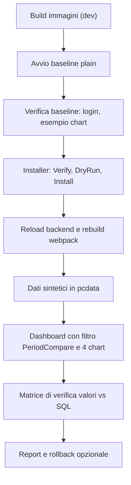

# Validazione end to end con Docker: Superset 6.1.0 + Period Compare

## 1. Obiettivo e architettura

- **Scopo**: avviare Superset 6.1.0 plain in Docker, applicare la patch Period Compare con l'installer, e verificare nel browser che Table, Big Number, ECharts Timeseries e Pivot Table mostrino il confronto tra periodi con i valori attesi.
- **Cartella di lavoro**: `C:\Users\franc\Desktop\SviluppoComparison\superset` (clone git del tag `6.1.0`, commit `c83fb2bb1d`, pulito).
- **Modalita**: Docker Compose "light" (Postgres + backend Flask con reload + webpack dev server sulla porta 9001), progetto Compose `spcompare`.
- **Dati**: sintetici, nessun dato reale. Database di prova `pcdata` nel Postgres del compose.
- **Rischio principale**: la build del frontend in dev mode ha bisogno di molta RAM (Docker ha circa 15 GB) e di molto tempo la prima volta.

## 2. Pre-flight

- [x] `AGENTS.md` letto (D:\Actual): operare su SSD, nessun OneDrive, nessun segreto in chiaro, niente trailer AI nei commit.
- [x] Docker Desktop 29.9.2 attivo, 12 CPU, circa 15 GB RAM, nessun container, porte 8088, 9000, 9001, 5432 libere, 205 GB liberi su C:.
- [x] Clone pulito: `git status` vuoto, tag `6.1.0`.
- [x] Credenziali: solo quelle di sviluppo del compose (`admin` / `admin`, `superset` / `superset`), valide solo su localhost. Nessun dato di cliente.
- [x] Windows: `core.autocrlf=true` (i file `docker/*.sh` restano LF grazie a `.gitattributes`).

## 3. Rischi

| Rischio | Mitigazione |
|:---|:---|
| `node_modules` su bind mount Windows lento | volume Docker dedicato `node_modules_spc` (file `docker-compose.spcompare.yml`) |
| `verify` dell'installer non riconosceva i file upstream (hash calcolati male, fine riga CRLF) | corretto in `3cb5706`, 4 test Pester |
| Webpack dev server esaurisce la memoria | monitorare con `docker stats`, alzare il limite di WSL se serve |
| La patch cambia `config.py` e `helpers.py` | il backend ricarica da solo (FLASK_DEBUG), verifica nei log |
| Dati di esempio di Superset (rete, tempo) | `SUPERSET_LOAD_EXAMPLES=no` in `docker/.env-local` |

## 4. Fasi e gate

### Fase 1: Baseline plain
1. `docker compose -p spcompare -f docker-compose-light.yml -f docker-compose.spcompare.yml up -d`
2. Gate: `http://localhost:9001` risponde, login `admin` / `admin`, nessun errore nei log di `superset-light` e `superset-node-light`.

### Fase 2: Applicazione della patch
1. `installer\PeriodCompare.ps1 -Action Verify -TargetDir <clone>`: atteso 25 su 25 "Matches Upstream".
2. `-Action DryRun`, poi `-Action Install -SkipBuild` (la build la fa il dev server).
3. Gate: `Verify` riporta 33 "Already Patched" e `MainPreset.ts` con i marcatori; webpack ricompila senza errori; il backend si riavvia senza errori; nessun file in `superset-frontend/plugins/superset-plugin-*` toccato.

### Fase 3: Dati e dashboard di prova
1. Generare le tabelle sintetiche `sales_performance` e `support_tickets` (24 mesi) nel database `pcdata`.
2. Registrare il database in Superset, creare i dataset con colonna temporale `order_date`.
3. Creare 4 chart (Table, Big Number Period over Period, Line/Bar Timeseries, Pivot Table v2) e una dashboard con un filtro nativo PeriodCompare.
4. Gate: la dashboard si apre e il filtro PeriodCompare compare tra i tipi disponibili.

### Fase 4: Matrice di verifica
Per ogni chart e per ogni caso, confrontare i numeri mostrati con una query SQL diretta su `pcdata`:

| Caso | Riferimento | Confronto | Modo |
|:---|:---|:---|:---|
| C1 | mese corrente | mese precedente | valori |
| C2 | mese corrente | stesso mese anno precedente | differenza |
| C3 | trimestre | trimestre precedente | percentuale |
| C4 | intervallo libero 12 giorni | altro intervallo libero | rapporto |
| C5 | febbraio bisestile | febbraio non bisestile | valori (allineamento 29/28) |
| C6 | grana giorno, settimana, mese | periodo precedente | valori (nessun buco nelle serie) |

Gate: scarto 0 tra valore visualizzato e SQL per tutti i casi, nessun errore nella console del browser, nessun errore 500 nei log del backend.

### Fase 5: Report
Report con esito per chart e caso, schermate, difetti trovati e correzioni (con commit). Aggiornare `SESSION_STATE.md`.

## 5. Evidence gate finale

- Suite Pester dell'installer: 9 su 9.
- Test Node: 28 e 5. Test backend: 17.
- Matrice della Fase 4 senza scarti.
- Rollback provato: `-Action Uninstall` riporta l'albero identico byte per byte.

## 6. Rollback

- Patch: `installer\PeriodCompare.ps1 -Action Uninstall -TargetDir <clone>` (ripristina da `.backups`).
- Ambiente: `docker compose -p spcompare -f docker-compose-light.yml -f docker-compose.spcompare.yml down -v` (elimina anche i volumi del progetto).
- Albero: `git -C <clone> status` deve tornare pulito, tranne `docker-compose.spcompare.yml` e `docker/.env-local`.
