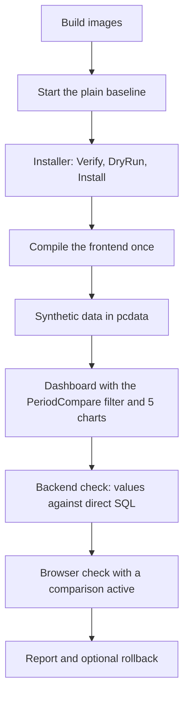

# End to end validation with Docker: Superset 6.1.0 + Period Compare

> Plan written on 2026-10-24 after the first release, to prove the patch inside a real Superset 6.1.0. What it found is recorded in the [changelog](../../CHANGELOG.md) and in [ADR 0004](../adr/0004-verify-against-the-real-build.md). The procedure that came out of it is in the [development guide](../development.md).

## 1. Goal and architecture

- **Purpose**: run a plain Superset 6.1.0 in Docker, apply the Period Compare patch with the installer, and check in the browser that Table, Big Number, ECharts Timeseries and Pivot Table show the comparison between periods with the expected values.
- **Working folder**: a Git clone of the `6.1.0` tag of Apache Superset, clean.
- **Mode**: Docker Compose, either the classic `docker-compose.yml` or `docker-compose-light.yml`. The frontend is compiled once (`npm run build-dev`) and served by the backend.
- **Data**: synthetic only, in a `pcdata` database inside the Postgres of the compose project.
- **Main risk**: the frontend build needs a lot of RAM and time the first time.

## 2. Pre-flight

- Docker Desktop running, enough RAM (at least 12 GB for the frontend build), free ports 8088 and 9000.
- Clean clone: `git status` empty, tag `6.1.0`.
- Credentials: only the development ones of the compose files (`admin` / `admin`, `superset` / `superset`), valid on localhost only. No customer data.
- On Windows: `core.autocrlf=true` is fine. `docker/*.sh` stay LF thanks to the Superset `.gitattributes`.

## 3. Risks

| Risk | Mitigation |
|:---|:---|
| `node_modules` on a Windows bind mount is slow | Docker volume for `node_modules` |
| `verify` of the installer did not recognize upstream files (hashes computed badly, CRLF) | fixed, with tests |
| Files copied with an old timestamp are skipped by `tsc -b` | the installer refreshes the timestamps |
| The webpack dev server polls the bind mount and serves bundles at about 30 KB/s | compile once with `npm run build-dev` |
| An interrupted build leaves a manifest that points to missing files | let the build finish; do not stop the container |
| The patch changes `config.py` and `helpers.py` | the backend reloads by itself; check the logs |

## 4. Phases and gates

### Phase 1: baseline
1. Start the stack with Docker Compose.
2. Gate: the application answers, login works, no errors in the logs.

### Phase 2: applying the patch
1. `installer\PeriodCompare.ps1 -Action Verify`: expect 25 of 25 "Matches Upstream".
2. `-Action DryRun`, then `-Action Install -SkipBuild`.
3. Gate: `Verify` reports 33 or more "Already Patched" and the markers in `MainPreset.ts`; no file in `superset-frontend/plugins/superset-plugin-*` touched.

### Phase 3: compilation
1. `npm run build-dev` in the node container.
2. Gate: `compiled successfully`, zero TypeScript errors.

### Phase 4: data and dashboard
1. `scripts/e2e/load-fixtures-postgres.py` loads the synthetic tables into `pcdata`.
2. `scripts/e2e/setup-test-dashboard.py` creates the database, the dataset, 5 charts and the dashboard with the PeriodCompare filter.
3. Gate: the dashboard opens and the filter is listed among the filter types.

### Phase 5: verification matrix
For every case, compare the values with a direct SQL query on `pcdata`:

| Case | Reference | Comparison | Mode |
|:---|:---|:---|:---|
| C1 | current month | previous month | values |
| C2 | current month | same month of the previous year | values |
| C3 | quarter by category | previous quarter | values |
| C4 | free range of 12 days | another free range | values |
| C5 | month | previous month | difference, percentage, ratio |
| C6 | March, daily | February (31 days against 28) | aligned by months |
| C7 | free range, daily | free range | aligned by days |
| C8 | quarter, monthly | previous quarter | aligned by months |

`scripts/e2e/verify-backend-compare.py` runs the matrix against the API and prints one line per check. The browser check opens the dashboard with a comparison applied (`scripts/e2e/set-dashboard-default.py`) and compares what each chart shows.

The synthetic data covers 2025 and 2026 only, so 29 February is not exercised here; it is covered by the date arithmetic tests.

Gate: difference 0 between displayed value and SQL for every case, no error in the browser console, no 500 in the backend logs.

### Phase 6: report
Outcome per chart and case, defects found and the commits that fixed them.

## 5. Final evidence gate

- Installer Pester suite green.
- Node tests and backend pytest green.
- Verification matrix with no differences.
- Rollback proven: `-Action Uninstall` puts the tree back byte for byte.

## 6. Rollback

- Patch: `installer\PeriodCompare.ps1 -Action Uninstall -TargetDir <clone>` (restores from `.backups`).
- Environment: `docker compose down` (add `-v` only to delete the volumes of the project as well).
- Tree: `git status` in the clone must be clean again, apart from the local compose overrides.
