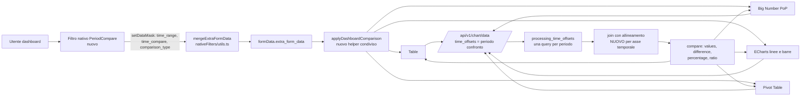

# Piano: confronto Periodo di Riferimento vs Periodo di Confronto in Superset 6.1.0

Progetto: `superset-period-compare` (nuova repository privata GitHub)
Versione target: Apache Superset 6.1.0, con struttura predisposta per le versioni future
Data piano: 2026-10-24
Esecutore previsto: Sonnet 5.5 (agenti Sonnet, con Haiku per lavoro meccanico)

---

> **Stato Attuazione**: 🟢 **Fasi 0..11 completate, v0.1.0** (verificato il 24/10/2026 rieseguendo le suite)
> - Backend Superset: 17/17 pytest passati (3 in `test_period_compare_backend.py`, 14 in `test_time_shifts.py`); sul gruppo piu ampio `common`, `models`, `pandas_postprocessing`, `utils/test_core.py` passano 470 test su 472, i 2 falliti (`test_dttm_sql_literal`) dipendono dal fuso orario del PC e non dalla patch
> - Frontend Arithmetic Engine: 28/28 test passati
> - Frontend Contracts: 5/5 test passati
> - Pester Installer Suite: 5/5 contesti passati (Clean, Custom plugins protection, Auto-detect, Rollback byte-for-byte)
> - Non coperto: compilazione del frontend (i test dell'installer usano `-SkipBuild`) e jest sui plugin
> - Test copiati nel repository in `tests/` (vedi `tests/README.md`)
> - Repository Privata GitHub: https://github.com/FrancescoCastaldi/superset-period-compare (isPrivate: true)

---

## 0. Principio guida: soluzione universale (correzione richiesta dall'utente)

Il progetto NON e' per un cliente. Il caso sanitario su SQL Server usato per capire il problema e' solo un esempio e non deve comparire nel codice, nei nomi dei file, nelle patch, nei test o nel titolo della documentazione. Requisiti di universalita':

| Asse | Requisito | Conseguenza nel piano |
|---|---|---|
| Cliente e dominio | Nessun riferimento a clienti, schemi o viste specifiche nel repository. Gli esempi usano domini generici (vendite, ticket di assistenza, prestazioni sanitarie, produzione) e dati sintetici. | Fixture multi-dominio (4.E), documento `docs/MIGRARE_DA_VISTE_CARTESIANE.md` generico, caso di partenza anonimizzato |
| Campo data | Funziona con qualsiasi colonna temporale del dataset: una per grafico, quella dell'asse X, quella del filtro `TEMPORAL_RANGE`, `granularity_sqla`, oppure scelta esplicitamente nel filtro. Nessun nome di colonna scritto nel codice. Tipi: DATE, DATETIME/TIMESTAMP, TIMESTAMP con fuso, stringa data (`YYYYMMDD`, `YYYY-MM-DD`), intero (anno-mese-giorno), epoch secondi e millisecondi (colonne `is_dttm` con `python_date_format`). | Matrice di test per tipo di colonna (sezione 8), controllo "Colonna di riferimento" nel filtro (4.C), ricerca della colonna temporale nel backend gia' presente (`_get_temporal_column_for_filter`, `helpers.py:1701`) |
| Database | Nessun SQL scritto a mano: tutto passa dal livello SQLAlchemy di Superset. Funziona su ogni motore che Superset supporta. | Test su SQLite (sempre) e PostgreSQL (se disponibile in WSL); note per SQL Server, MySQL, ClickHouse, Oracle, BigQuery sui time grain (`superset/db_engine_specs/`) |
| Grana temporale | Non solo mese: anche minuto, ora, giorno, settimana (tutte le varianti), mese, trimestre, anno. | Test di allineamento per ogni grana (4.A) |
| Grafici | I quattro grafici dell'elenco, ma l'helper e' esportato dal pacchetto dei controlli cosi' qualsiasi plugin (anche di terzi) lo adotta con poche righe. | `applyDashboardComparison` esportato con documentazione e test (4.B) |
| Lingua | Interfaccia del filtro e dei grafici in italiano e inglese tramite il sistema di traduzione di Superset. | File `.po` o dizionario nel payload (4.C) |
| Installazione | Nessun percorso, nome utente o server dell'utente scritto nei file distribuiti. Il percorso di Superset e' un parametro. | Installer parametrico (5.2) |
| Versioni | 6.1.0 oggi, predisposto per le successive. | 5.4 |

---

## 1. Contesto e obiettivo

### 1.1 Il problema
Il confronto tra un periodo di riferimento (il periodo attuale, scelto dall'utente) e un periodo di confronto (un altro periodo, scelto dall'utente) e' una funzione comune in strumenti BI come Qlik Sense, ma Superset non ha un controllo per sceglierli entrambi. Chi ne ha bisogno ripiega su un prodotto cartesiano nelle viste SQL. Caso di partenza (un cliente sanitario su SQL Server, usato solo come esempio):

- Vista dei fatti incrociata con se stessa: `CROSS JOIN` di tutti i mesi con tutti i mesi, poi `JOIN ... ON (mese = corrente) OR (mese = confronto)`.
- Risultato misurato: 8,5 milioni di righe nella finestra contro circa 220.000 righe di base (39 volte), con latenze di 6 secondi sul grafico peggiore e con 4 filtri a tendina (anno e mese, per riferimento e confronto) che servono solo a "collassare" la griglia a una coppia.
- Le metriche del periodo di confronto devono essere protette con un `CASE WHEN COUNT(DISTINCT ...)=1`, altrimenti i volumi si moltiplicano (inflazione misurata 13 volte).
- Il periodo e' solo il mese (anno e mese interi): niente intervalli liberi.

Questo schema si trova, con varianti, in qualunque installazione Superset che deve confrontare due periodi. Il problema da risolvere e' generale.

### 1.2 L'obiettivo
Avere nei dataset un solo campo timestamp completo (qualunque sia il suo nome) e lasciare che sia Superset a:

1. permettere all'utente della dashboard di scegliere due intervalli liberi (riferimento e confronto), con scorciatoie (periodo precedente, stesso periodo anno scorso, personalizzato);
2. far arrivare i due periodi a tutti i grafici interessati;
3. mostrare per ogni metrica: valore riferimento, valore confronto, differenza, differenza percentuale.

Grafici da coprire per primi (risposta dell'utente): Table, Big Number, barre e linee ECharts, Pivot Table.

### 1.3 Cosa ho scoperto in Superset 6.1.0 (verificato sul codice)
La buona notizia: il motore sa gia' fare un confronto con intervallo arbitrario sulla stessa colonna temporale. Mancano il filtro di dashboard, il collegamento ai grafici e l'allineamento per i grafici temporali.

| Cosa | Dove (relativo a `superset-6.1.0`) | Stato |
|---|---|---|
| `time_offsets` con formato intervallo `"YYYY-MM-DD : YYYY-MM-DD"` | `superset/models/helpers.py:1355-1641` (`processing_time_offsets`), `superset/common/query_object.py:306-321` | Esiste, spento di default (`DATE_RANGE_TIMESHIFTS_ENABLED`, `superset/config.py:564`) |
| Una query SQL in piu' per ogni offset sul periodo di confronto | `helpers.py:1596`, `self.query(...)` | Esiste, riusa il caching e i filtri |
| Colonne `metrica__<offset>` | `superset/utils/core.py:126` (`TIME_COMPARISON = "__"`) | Esiste |
| Calcolo difference / percentage / ratio | `superset/utils/pandas_postprocessing/compare.py`, enum in `superset/constants.py:236` | Esiste |
| Filtro che emette `time_range` | `src/filters/components/Time/TimeFilterPlugin.tsx:91-106` | Esiste ma emette solo `time_range` |
| Chiave `time_compare` nei filtri nativi | `packages/superset-ui-core/src/query/constants.ts:30-62` (override regolare) | La chiave viaggia, ma solo Table e AG-Grid la leggono (`plugin-chart-table/src/buildQuery.ts:119-124`) |
| Nessun filtro nativo imposta il confronto | `src/filters/components/` (Range, Select, Time, TimeColumn, TimeGrain) | Manca |
| Big Number con confronto | `plugin-chart-echarts/src/BigNumber/BigNumberPeriodOverPeriod/` | Esiste, solo con `CHART_PLUGINS_EXPERIMENTAL` e legge solo il proprio `time_compare` |
| Linee e barre con confronto | `plugin-chart-echarts/src/Timeseries/buildQuery.ts:81` | Esiste, solo offset relativi dai controlli del grafico |
| Pivot Table | `plugin-chart-pivot-table/src/plugin/buildQuery.ts` | Nessun supporto al confronto |

Tre difetti da correggere nel backend, trovati leggendo il codice:

1. **Allineamento per i grafici temporali.** Con un offset a intervallo, `_process_date_range_offset` (`helpers.py:1736-1760`) toglie dalle chiavi di join solo le colonne chiamate `ds`, `__timestamp`, `dttm`. Se l'asse X ha il nome reale della colonna (per esempio `order_date`) resta una chiave di join: le date di riferimento e di confronto non coincidono mai e la colonna confronto torna vuota. Per i KPI e le tabelle per dimensione funziona, per le linee no. Soluzione: traslare la colonna temporale del dataframe di confronto della distanza tra i due inizi periodo e poi usare lo stesso join per grana (`generate_join_column`, `helpers.py:1941`) gia' usato dagli offset relativi.
2. **`_apply_filters`** (`superset/common/query_context_factory.py:311-315`) sovrascrive ogni filtro `TEMPORAL_RANGE` con `time_range`: una query ha un solo periodo. Un secondo filtro temporale NON e' la strada. Va usato `time_offsets`.
3. **`custom_form_data` e' scartato** sia dal merge frontend (`nativeFilters/utils.ts:109`, `isIterable`) sia da `merge_extra_form_data` (`superset/utils/core.py:1047`, bug nel ciclo append). Non usare `custom_form_data`.

Altri fatti utili:
- Per le query di confronto Jinja `{{ from_dttm }}` e `{{ to_dttm }}` assumono gia' le date del periodo di confronto, ma `get_time_filter()` legge il form data grezzo e restituisce sempre il riferimento. Nessuna modifica a Jinja: e' il livello sbagliato.
- La query di confronto e' una query completa: per una vista da 220.000 righe sono 2 query leggere, contro una vista da 8,5 milioni di righe.
- In questo albero `MainPreset.ts` (righe 91-120) registra i 5 plugin tuoi dalla cartella `superset-frontend/plugins/` e il `superset_config.py` radice abilita solo `ENABLE_TEMPLATE_PROCESSING`. L'albero ha circa 6.367 voci "modificate" dovute a fine riga (CRLF); i file realmente cambiati sono 9 (Dockerfile, compose, config, package.json, MainPreset, webpack).

---

## 2. Decisioni prese con l'utente

| Tema | Decisione |
|---|---|
| Forma repository | Repo di soli file modificati, con spiegazione completa e `.bat` automatico che installa "hands free" su un Superset 6.1.0 esistente. Predisposta ad aggiornamenti futuri. |
| Plugin dell'utente | Non devono essere toccati dalla patch (kpi_comparison, hierarchical_table, calendar_filter, stratum_bar, stratum_heatmap). |
| Grafici | Table, Big Number, barre e linee ECharts, Pivot Table. |
| Selezione periodo | Intervalli liberi piu' scorciatoie (periodo precedente, stesso periodo anno scorso, personalizzato). |
| Ambiente di prova | Nativo Windows: venv Python 3.11 con `uv`, `npm` nel checkout 6.1.0, backend su SQLite con dati sintetici, UI con dev-server. Niente Docker (rimosso dall'utente). |
| Plugin tuoi per il confronto | Fase separata e opzionale, in branch dei loro repository, non nella patch. |
| Esito finale | Test, poi repository privata GitHub `FrancescoCastaldi/superset-period-compare` e push. |

---

## 3. Architettura della soluzione



Principi:

1. **Una sola colonna timestamp nella vista.** Nessun cartesiano, nessun flag di periodo. Il periodo di confronto e' un'altra query sulla stessa vista.
2. **Zero nuovi motori.** Si riusa `time_offsets`, il formato intervallo e `compare`. Il codice nuovo e' il minimo necessario.
3. **Un solo punto di integrazione per i grafici:** un helper `applyDashboardComparison(formData)` che traduce `extra_form_data.time_compare` e `comparison_type` in `time_compare`, `comparison_type` e `time_offsets` effettivi. Ogni grafico lo chiama in cima a `buildQuery` e `transformProps`.
4. **Opt-in per grafico.** Un grafico che non conosce le colonne `metrica__<offset>` non va forzato (la pipeline di pivot delle serie ECharts si romperebbe con colonne inattese). Per questo il collegamento e' per grafico e non globale in `buildQueryObject`.
5. **Convenzione periodi:** intervalli semiaperti `[inizio, fine)`, come i `time_range` di Superset. Il filtro emette le fine esclusive.

### 3.1 Contratto dati (da congelare nella Fase 1)

`extraFormData` emesso dal filtro:

```
time_range:      "2026-09-01 : 2026-10-01"      periodo di riferimento, fine esclusa
time_compare:    "2026-08-01 : 2026-09-01"      periodo di confronto, formato intervallo
comparison_type: "values"                       values | difference | percentage | ratio
```

`filterState` del filtro: `{ value: { reference, comparison, preset }, label }`.

Colonne restituite dal backend per un offset a intervallo: `metrica` (riferimento) e `metrica__2026-08-01 : 2026-09-01` (confronto). Per `comparison_type` diverso da `values`: `difference__metrica__metrica__<offset>` e simili (nomi gia' prodotti da `compare.py`).

Regola di allineamento (backend): la colonna temporale del confronto viene traslata di `inizio_riferimento - inizio_confronto`. Se entrambi gli inizi sono primi del mese la traslazione e' in mesi interi (`DateOffset(months=n)`), altrimenti in giorni. Poi join per grana temporale come per gli offset relativi. Periodi di lunghezza diversa: le posizioni mancanti in coda risultano vuote, mai spostate.

---

## 4. Modifiche per area (cosa cambiare e come)

I percorsi sono relativi alla radice di Superset 6.1.0. "NUOVO" = file nuovo, "PATCH" = modifica a file upstream, "ANCORA" = inserimento idempotente tra marcatori in file che l'utente ha gia' personalizzato.

### 4.A Backend (Agente A)

| File | Tipo | Modifica |
|---|---|---|
| `superset/models/helpers.py` | PATCH | In `processing_time_offsets`: per gli offset a intervallo calcolare e conservare la traslazione (`outer_from - offset_from`). Passarla a `join_offset_dfs`. |
| `superset/models/helpers.py` | PATCH | `_process_date_range_offset`: se esiste la colonna asse X (join key temporale reale) traslarla e restituirla come chiave, invece di scartare solo `ds/__timestamp/dttm`. Mantenere il comportamento attuale per KPI e tabelle senza asse temporale. |
| `superset/models/helpers.py` | PATCH | `_determine_join_keys`: con `time_grain` usare la chiave per grana anche per gli offset a intervallo (dopo la traslazione, `time_offset=None` in `generate_join_column`). |
| `superset/common/query_object.py` | PATCH | `_is_valid_date_range` e `is_valid_date_range` (`helpers.py:1665`): accettare anche estremi ISO con orario (`YYYY-MM-DDTHH:MM:SS`), cosi' un timestamp completo funziona. Se l'estremo e' solo data, comportamento invariato. |
| `superset/constants.py` | PATCH | Aggiungere `time_compare` e `comparison_type` a `EXTRA_FORM_DATA_OVERRIDE_REGULAR_MAPPINGS` (righe 179-204), cosi' report, miniature ed embed ricevono il confronto. Stessa lista in `superset/migrations/shared/migrate_viz/query_functions.py:89-117` non va toccata. |
| `superset/utils/core.py` | PATCH | Verificare `merge_extra_form_data` (riga 1047): non e' necessario correggere il bug di `custom_form_data`, quindi non toccarlo; solo coprire con un test che `time_compare` si fonde come override regolare. |
| `docker/pythonpath_dev/superset_config.py` (o `superset_config.py` radice) | ANCORA | Blocco con `DATE_RANGE_TIMESHIFTS_ENABLED: True` e `CHART_PLUGINS_EXPERIMENTAL: True` dentro `FEATURE_FLAGS`, senza toccare i flag esistenti (ALERT_REPORTS, DASHBOARD_CROSS_FILTERS, ecc. gia' presenti). |

Test backend (pytest, TDD, nello stesso albero): estendere `tests/unit_tests/common/test_time_shifts.py` e `tests/unit_tests/common/test_query_context_processor.py`:
- offset a intervallo con asse temporale reale e grana mese: confronto allineato, nessun NaN spurio;
- periodi di lunghezza diversa (31 contro 30 giorni): code vuote, non spostate;
- offset a intervallo con dimensioni (join sulle dimensioni) e senza dimensioni (cross join di una riga): invariato;
- piu' offset insieme (due confronti);
- estremi con orario;
- `comparison_type` difference, percentage, ratio con colonne a intervallo;
- flag spento: errore chiaro e invariato.

### 4.B Frontend core (Agente B)

| File | Tipo | Modifica |
|---|---|---|
| `superset-frontend/packages/superset-ui-core/src/query/constants.ts` | PATCH | Aggiungere `comparison_type` a `EXTRA_FORM_DATA_OVERRIDE_REGULAR_MAPPINGS` (`time_compare` c'e' gia'). |
| `superset-frontend/packages/superset-ui-core/src/query/types/QueryFormData.ts` | PATCH | Tipi: `extra_form_data.time_compare`, `comparison_type`. |
| `superset-frontend/packages/superset-ui-chart-controls/src/utils/applyDashboardComparison.ts` | NUOVO | `applyDashboardComparison(formData)` e `resolveTimeOffsets(formData, baseQueryObject)`: il confronto della dashboard vince su quello impostato nel grafico; restituisce `{ formData, timeOffsets, comparisonType, isComparing }`. Riusa `ensureIsArray`, `isTimeComparison` (`utils/isTimeComparison.ts`) e `getMetricOffsetsMap` (`utils/getMetricOffsetsMap.ts`). |
| `superset-frontend/packages/superset-ui-chart-controls/src/utils/index.ts` | PATCH | Export dell'helper. |
| `superset-frontend/packages/superset-ui-chart-controls/src/sections/timeComparison.tsx` | PATCH | Aggiungere un controllo `follow_dashboard_comparison` (checkbox, default `true`) che disattiva il collegamento al filtro per un singolo grafico. |
| `.../utils/isTimeComparison.ts` | PATCH | Considera attivo il confronto anche quando arriva solo da `extra_form_data.time_compare`. |

Test (Jest): `applyDashboardComparison.test.ts` (priorita' dashboard su grafico, formato intervallo, assenza di confronto, `follow_dashboard_comparison=false`, `comparison_type` di default), piu' una nuova casistica in `src/dashboard/components/nativeFilters/utils.test.ts` per il merge di `time_compare` e `comparison_type` con due filtri (vince l'ultimo).

### 4.C Nuovo filtro nativo "Periodo di riferimento e confronto" (Agente C)

Modello: `src/filters/components/Time/` (stessa struttura, `datasourceCount: 0`, quindi non chiede dataset ne' colonna). Per default il periodo si applica alla colonna temporale di ciascun grafico (asse X, filtro `TEMPORAL_RANGE` o `granularity_sqla`), qualunque essa sia: cosi' funziona su dataset diversi con colonne data diverse nella stessa dashboard.

Controllo opzionale "Colonna di riferimento" nel pannello del filtro (`reference_column`): vuoto = ogni grafico usa la propria colonna; valorizzato con il nome di una colonna = il filtro emette anche `extraFormData.granularity_sqla` con quel nome (chiave override gia' esistente in `superset-ui-core/src/query/constants.ts`), utile quando un dataset ha piu' colonne data (per esempio data ordine e data spedizione) e la dashboard deve usarne una precisa. Nessun nome di colonna nel codice.

| File | Tipo | Contenuto |
|---|---|---|
| `src/filters/components/PeriodCompare/index.ts` | NUOVO | `PeriodCompareFilterPlugin extends ChartPlugin`, `Behavior.NativeFilter` e `InteractiveChart`, miniatura. |
| `.../PeriodCompare/PeriodCompareFilterPlugin.tsx` | NUOVO | UI: due `DateFilterControl` (riuso da `src/explore/components/controls/DateFilterControl`, usa gia' `/api/v1/time_range/`); tendina scorciatoie per il confronto; selettore `comparison_type`. |
| `.../PeriodCompare/controlPanel.ts`, `transformProps.ts`, `types.ts` | NUOVO | Come `Time/`. |
| `.../PeriodCompare/utils/resolveComparison.ts` | NUOVO | Funzioni pure: dal riferimento assoluto `[a, b)` calcola il confronto per preset `previous_period` (stessa durata subito prima), `previous_year` (stesso intervallo meno un anno, in mesi), `previous_month`, `custom`. Gestione 29 febbraio, fine mese, anni bisestili. |
| `src/filters/components/index.ts` | PATCH | Export. |
| `src/constants.ts` (enum `FilterPlugins`, riga 185) | PATCH | `PeriodCompare = 'filter_periodcompare'`. |
| `src/visualizations/presets/MainPreset.ts` | ANCORA | `new PeriodComparePlugin().configure({ key: FilterPlugins.PeriodCompare })` accanto a `TimeFilterPlugin` (riga 187), piu' l'import. Marcatori `period-compare:begin/end`, gli altri plugin dell'utente restano identici. |
| `.../FiltersConfigForm/constants.ts` | ANCORA | `filter_periodcompare: [GenericDataType.Temporal]` in `FILTER_SUPPORTED_TYPES`. |
| `.../FiltersConfigForm/FiltersConfigForm.tsx`, `DefaultValue.tsx` | PATCH | Tutti i punti che trattano `filter_time` in modo speciale (righe 667, 962, 1042, `DefaultValue.tsx:58`) devono trattare anche `filter_periodcompare`. Da cercare con `grep -n "filter_time"` e verificare uno per uno. |
| `.../hooks/useFilterOperations.ts` | verifica | `ALLOW_DEPENDENCIES`: il nuovo filtro non dipende da altri. |

Comportamento del filtro:
1. Utente sceglie il riferimento (qualsiasi `time_range` supportato da `DateFilterControl`, anche relativo come "ultimi 30 giorni").
2. Il filtro risolve il riferimento in date assolute (chiamata a `/api/v1/time_range/` gia' usata dal controllo) e calcola il confronto dalla scorciatoia scelta.
3. Emette `extraFormData = { time_range, time_compare, comparison_type }`. Con "nessun confronto" emette solo `time_range`.
4. Valore predefinito configurabile nella finestra dei filtri (come per il filtro Time).

Test: Jest sulle funzioni pure di `resolveComparison` (almeno 25 casi: mese, trimestre, anno, bisestile, fine mese, settimana, intervallo di un giorno) e React Testing Library sul componente (cambio preset, cancellazione, ripristino valore salvato).

### 4.D Grafici (Agenti D1, D2, D3: in parallelo dopo la Fase 3)

Schema comune per ogni grafico: all'inizio di `buildQuery` e di `transformProps` chiamare `applyDashboardComparison(formData)`; usare `timeOffsets`; non cambiare nulla quando il confronto non e' attivo (regressione zero, verificata dai test esistenti).

**D1: Table e Big Number**

| File | Modifica |
|---|---|
| `plugins/plugin-chart-table/src/buildQuery.ts:119-124` | Sostituire la logica sparsa con `resolveTimeOffsets` (stesso risultato, comportamento esistente invariato). |
| `plugins/plugin-chart-table/src/transformProps.ts:550` | `isUsingTimeComparison` vero anche quando il confronto arriva dalla dashboard e `comparison_type` e' `values`. Le colonne `Main X`, `# X`, `△ X`, `% X` (`processComparisonColumns:383`) vengono riusate come sono. Etichetta della colonna confronto con le due date, non con la stringa grezza. |
| `plugins/plugin-chart-echarts/src/BigNumber/BigNumberPeriodOverPeriod/buildQuery.ts` e `transformProps.ts:139-157` | Chiamare l'helper; gestire l'offset a intervallo in `getMetricOffsetsMap` (il nome colonna contiene ` : `). |
| `.../PopKPI.tsx` | Mostrare le due date di confronto nell'etichetta. |

**D2: Barre e linee ECharts (Timeseries, MixedTimeseries)**

| File | Modifica |
|---|---|
| `plugins/plugin-chart-echarts/src/Timeseries/buildQuery.ts:81` | `time_offsets` da `resolveTimeOffsets`; passare a `timeCompareOperator` un `formData` con `time_compare` e `comparison_type` effettivi (l'operatore legge `formData.time_compare`). |
| `.../Timeseries/transformProps.ts:381-411` | Nome serie confronto: `metrica (confronto 2026-08-01 : 2026-09-01)`, leggibile nella legenda; stile tratteggiato per il confronto, colori coerenti con il riferimento. |
| `.../Timeseries/Regular/*` e `Mixed*` | Verifica che la serie confronto usi lo stesso asse X del riferimento (grazie all'allineamento backend). |

**D3: Pivot Table v2 (il piu' rischioso, ultimo)**

| File | Modifica |
|---|---|
| `plugins/plugin-chart-pivot-table/src/plugin/buildQuery.ts` | Aggiungere `time_offsets` e, per `comparison_type` diverso da `values`, il passaggio `compare` come nelle altre. |
| `plugins/plugin-chart-pivot-table/src/plugin/transformProps.ts` | Aggiungere all'elenco metriche `metrica__<offset>` e le metriche derivate (differenza e percentuale) con etichette comprensibili; formattazione uguale alla metrica base. |
| `plugins/plugin-chart-pivot-table/src/plugin/controlPanel.tsx` | Sezione `timeComparisonControls` e `follow_dashboard_comparison`. |

Test per ogni grafico: i test esistenti restano verdi senza modifiche e se ne aggiungono di nuovi (confronto attivo e non attivo, un offset, offset a intervallo, `comparison_type` diversi, metrica con nome contenente spazi e parentesi, `follow_dashboard_comparison=false`).

### 4.E Migrazione da viste cartesiane, dataset di prova e benchmark (Agente E, che riprende il lavoro in Fase 8)

Obiettivo: dare a qualunque cliente la ricetta per togliere il prodotto cartesiano dalle proprie viste e usare un solo campo timestamp. Il caso di partenza (cliente sanitario su SQL Server) serve solo come esempio e nel repository compare in forma anonima ("caso di studio A"), mai con nomi di viste, schemi o server reali.

Ricetta generica (da documentare in `docs/MIGRARE_DA_VISTE_CARTESIANE.md`):

| Prima (prodotto cartesiano) | Dopo (patch installata) |
|---|---|
| Vista dei fatti incrociata con l'elenco dei periodi (`CROSS JOIN` periodi x periodi) | Vista dei fatti con una sola colonna timestamp completa (o dataset fisico/virtuale equivalente) |
| N filtri a tendina (anno e mese, per riferimento e confronto) | 1 filtro `PeriodCompare` (riferimento + confronto), intervalli liberi |
| Metriche duplicate `m_corrente`, `m_confronto` con flag `IS_CORRENTE`, `IS_CONFRONTO` | Metrica unica `m`; il confronto e' la colonna `m__<intervallo>` prodotta da Superset |
| Protezioni `CASE WHEN COUNT(DISTINCT periodo)=1 THEN ... ELSE NULL END` contro l'inflazione | Non servono piu': nessuna moltiplicazione di righe |
| Vista "mese su mese" (lag 1) | Scorciatoia "periodo precedente" o offset relativo `1 month ago` |
| Righe lette: fatti x coppie di periodi (nel caso di studio A, 39 volte i fatti di base) | Righe lette: fatti del periodo, 1 query per periodo |

Cose da non portare via automaticamente: colonne di classificazione calcolate sul periodo scelto (per esempio "mese di picco", "top 10 del periodo"). Non sono confronti tra due periodi: restano nella vista fino a una riprogettazione dedicata. Va scritto nel documento come "controllo manuale".

Attivita':
1. Documento `docs/MIGRARE_DA_VISTE_CARTESIANE.md`: ricetta sopra, checklist per dataset (colonna temporale, tipo, `is_dttm`, `python_date_format`, fuso orario), esempi per tipo di colonna, regole per metriche non additive (medie, rapporti, conteggi distinti: ogni periodo e' una query a se', quindi il risultato e' corretto; documentarlo), come ricreare le metriche derivate.
2. **Fixture sintetiche multi-dominio** in `tests/fixtures/` (nessun dato reale o personale): `vendite` (ordini, 24 mesi), `ticket` (assistenza, data apertura e data chiusura), `prestazioni` (sanitario generico), tutte con almeno una colonna data e una metrica additiva e una non additiva. Generatore parametrico (righe, mesi, seme casuale) cosi' i test sono ripetibili.
3. **Una variante di colonna data per fixture** (matrice della sezione 8): DATE, DATETIME, TIMESTAMP con fuso, stringa `YYYYMMDD`, stringa `YYYY-MM-DD`, intero `YYYYMMDD`, epoch secondi, epoch millisecondi.
4. Dashboard di dimostrazione (export YAML) con i quattro tipi di grafico e il nuovo filtro, importabile su un Superset 6.1.0 con le fixture.
5. Script di benchmark `tools/benchmark_chart_data.py`: confronta una vista cartesiana sintetica con la vista base piu' confronto (righe lette, latenza, numero di query). Parametri e credenziali solo da variabili d'ambiente, mai nel repository.
6. Checklist per la prova su un server reale a cura dell'utente (qualunque motore): query SQL di riferimento da confrontare con il grafico, controlli sui bordi (periodi senza dati, fine mese, anno bisestile).
7. Avvertenza generale nel README: provare sempre su un'istanza di sviluppo, non su dashboard in uso.

### 4.F Plugin dell'utente (Fase 9, opzionale, repository separati)

Non fa parte della patch. In un branch di ciascun repository (`superset-extensions`, `superset-plugins`):
- `superset-plugin-chart-kpi-comparison/src/plugin/buildQuery.ts:151-160`: aggiungere un quarto modo `dashboard_comparison` che usa `applyDashboardComparison` (circa 10 righe). Oggi il modo `dual_metric` richiede due metriche distinte con flag di periodo nella vista.
- `superset-plugin-chart-hierarchical-table`: `src/utils/timeComparison.ts` e `processors/time_comparison.py` hanno un loro modello di confronto; valutare se leggere `extra_form_data.time_compare`.
- `calendar_filter`: aggiungere in `src/utils/filterMask.ts` l'emissione facoltativa di `time_compare`, oppure lasciare che sia il nuovo filtro a farlo.
Questi cambi dipendono dall'helper della patch: documentarlo come requisito.

---

## 5. Repository privata e installer automatico

Cartella locale: `D:\Actual\03_Sviluppo_Software\Repositories\superset-period-compare` (da creare con `git init`, branch `main`).

### 5.1 Struttura

```
superset-period-compare/
  README.md                  guida completa in italiano (cosa fa, requisiti, installazione, uso, aggiornamento)
  AGENTS.md  codemap.md  CHANGELOG.md  LICENSE  NOTICE  .gitignore
  install.bat  uninstall.bat  verify.bat  dry-run.bat        lanciatori (doppio clic)
  installer/
    PeriodCompare.ps1        punto di ingresso: -Target <radice Superset> -Action install|uninstall|verify|dry-run
    compat.json              versioni supportate -> payload, impronte dei file attesi
    lib/                     detect, patch, anchors, backup, guard-plugins, config, report
  payload/
    6.1.0/
      new/                   file nuovi, con la stessa struttura dell'albero Superset
      patches/               NN-nome.patch (diff unificati su file upstream)
      anchors/               *.json (inserimenti idempotenti in file personalizzati)
  tools/
    make-payload.ps1         da branch git del checkout di lavoro a payload/<versione>
    rebase-patches.ps1       porta le patch su una nuova versione (git am / cherry-pick) e segnala i conflitti
    new-version.ps1          crea payload/<nuova versione> da una precedente
    benchmark_chart_data.py
  docs/
    CONTRATTO.md  ARCHITETTURA.md  INSTALLAZIONE.md  AGGIORNARE_VERSIONE.md
    MIGRARE_DA_VISTE_CARTESIANE.md  plans/2026-10-24-period-compare.md
  tests/
    installer/               test Pester
    fixtures/                albero Superset minimo e dati sintetici
  examples/                  frammento superset_config, export dashboard dimostrativa
```

Convenzioni del tuo ambiente da rispettare (da `AGENTS.md`): `.gitignore` dal modello `D:\Actual\03_Sviluppo_Software\Repositories\templates\gitignore.template` (con `!CHANGELOG.md`, `!README.md`, `!docs/`), `CHANGELOG.md` dal modello Keep a Changelog 1.1.0 con SemVer, UTF-8 senza BOM, nessun trattino lungo o doppio trattino come punteggiatura, `;` al posto di `&&` in PowerShell, commit convenzionali con `-s`. Nome in kebab-case.

### 5.2 Comportamento dell'installer (tutto automatico, nessuna domanda)

`install.bat` chiede al massimo il percorso di Superset la prima volta (lo memorizza in `.period-compare/target.txt`; accetta anche il parametro). Poi, in ordine:

1. **Pre-controlli.** Riconosce la radice (`superset/__init__.py` e `superset-frontend/package.json`), legge la versione, verifica `git` nel PATH. Versione sconosciuta: se maggiore e' possibile `-AllowNearest` (vedi 5.4), altrimenti rifiuta senza toccare nulla.
2. **Fotografia di sicurezza dei tuoi plugin.** Calcola l'hash di ogni cartella `superset-frontend/plugins/superset-plugin-chart-*` e salva le righe di `MainPreset.ts` che registrano plugin non upstream.
3. **Backup** dei soli file che saranno modificati in `.period-compare/backup/<data-ora>/`.
4. **Applicazione transazionale** in un'area di appoggio: file nuovi (copiati; se esiste gia' un file diverso con lo stesso nome si ferma), patch (`git apply --check` poi `git apply --ignore-space-change --whitespace=nowarn`, funziona anche fuori da un repo git e con fine riga CRLF), ancore, blocco di configurazione.
5. **Controllo plugin.** Ricalcola gli hash del punto 2: devono essere identici, e le registrazioni dei tuoi plugin devono essere tutte ancora presenti. Altrimenti ripristina il backup e termina con errore e rapporto.
6. **Manifesto.** Scrive `.period-compare/manifest.json` con versione payload, file toccati, hash prima e dopo.
7. **Rapporto** a video e in `.period-compare/install-report.txt`, con i passi successivi (ricostruire l'immagine: `docker compose -f docker-compose-non-dev.yml up -d --build`, oppure `npm run build` e riavvio). Con `-Rebuild` esegue la ricostruzione se `docker` e' disponibile.

Proprieta' garantite e testate:
- **Idempotente:** rilanciarlo non cambia nulla (marcatori `period-compare:begin/end` nelle ancore, `git apply --reverse --check` per capire se una patch e' gia' applicata).
- **Reversibile:** `uninstall.bat` ripristina byte per byte i file originali dal manifesto.
- **Non invasivo sui tuoi plugin:** nessun file dentro `superset-frontend/plugins/superset-plugin-*` viene scritto, mai. La sola riga che tocca `MainPreset.ts` e' un inserimento tra marcatori accanto a `TimeFilterPlugin`, indipendente dalle righe dei tuoi plugin.
- **`dry-run.bat`:** mostra cosa farebbe e quali file toccherebbe, senza scrivere.
- **`verify.bat`:** confronta l'albero con il manifesto, segnala deviazioni (per esempio dopo un aggiornamento di Superset che ha sovrascritto file).

### 5.3 Riferimenti dell'utente da riusare
- Controllo `node_modules` e `npm install` automatico prima della build: regola dell'`AGENTS.md` di `superset-plugins` (blocco "Pre-Flight").
- Catena di fallback degli script `build` (`tsc || node ... || npx tsc`).
- Stile degli installer esistenti: `superset-plugins/superset-plugin-chart-calendar-filter/install-plugin.ps1` (normalizzazione idempotente di `MainPreset.ts`, backup `.bak`).
- `Dockerfile` personalizzato dell'utente: `node:20-trixie-slim`, heap 8192, `npm ci --legacy-peer-deps`. La patch non lo modifica.

### 5.4 Predisposizione per le versioni future
- `compat.json` mappa `versione Superset -> directory payload` piu' un elenco di file con hash upstream attesi (impronta della versione).
- Versioni `6.1.x`: usano il payload 6.1.0 con tolleranza di contesto (`git apply -C1`).
- Versione non nota (per esempio 6.2.0): `-AllowNearest` prova il payload piu' vicino con `-C1 --recount`; se tutto si applica lo segnala come "non certificato", altrimenti produce un rapporto per file e hunk in conflitto e non scrive nulla.
- Per certificare una nuova versione: `tools/new-version.ps1 -From 6.1.0 -To 6.2.0` crea il checkout di lavoro, applica le patch con `git am --3way`, mostra i conflitti da risolvere, rigenera il payload con `tools/make-payload.ps1`, rilancia i test. Procedura documentata passo passo in `docs/AGGIORNARE_VERSIONE.md`.
- Le modifiche sono tenute il piu' piccole e localizzate possibile (un helper nuovo, poche righe per grafico) proprio per rendere i rebase banali.

---

## 6. Orchestrazione degli agenti

Numero di agenti: 8 ruoli (E, K, A, B, C, D, I, R; piu' l'orchestratore, cioe' la sessione principale). Massimo 3 in parallelo per contenere i token. Tutti Sonnet 5.5, tranne il revisore (Opus 5.5 solo ai gate di fase) e il lavoro meccanico (documenti, scaffolding) che puo' andare su Haiku.

| Agente | Compito | Possiede (nessuno scrive fuori dal proprio perimetro) | Dipende da |
|---|---|---|---|
| **E: ambiente** | Fase 0: checkout pulito, venv, npm, baseline test, dataset sintetico | `_work/` fuori dal repo, `tests/fixtures/` | niente |
| **K: contratto** | Fase 1: `docs/CONTRATTO.md`, tipi condivisi | `docs/`, `payload/6.1.0/new/.../applyDashboardComparison.ts` (stub e firma) | E |
| **A: backend** | Sezione 4.A | `superset/`, `tests/` Python | K |
| **B: frontend core** | Sezione 4.B | `packages/superset-ui-*` | K |
| **C: filtro** | Sezione 4.C | `src/filters/components/PeriodCompare/`, registrazioni | K, B (helper) |
| **D: grafici** | Sezione 4.D (D1 poi D2 poi D3, un solo agente in sequenza per non fare conflitti) | `plugins/plugin-chart-*` | B |
| **I: installer e documenti** | Sezione 5, test Pester, README e docs | `installer/`, `tools/`, `docs/`, `tests/installer/` | K (puo' partire in parallelo con A, B) |
| **R: revisore** | Gate di fine fase: revisione codice, `/simplify`, controllo regole del repo, scansione segreti | sola lettura | a ogni gate |

Ordine e parallelismo:

```
Fase 0 (E)                                   gate G0
Fase 1 (K)                                   gate G1  congelamento contratto
Fase 2 (A)  |  Fase 3 (B)  |  Fase 6 (I)     parallelo, gate G2 a fine di ciascuna
Fase 4 (C)  |  Fase 5 (D)                     dopo B, parallelo tra loro, gate G3
Fase 7 integrazione e prova end to end       gate G4
Fase 8 migrazione, dati di prova, benchmark  gate G5
Fase 9 plugin dell'utente (opzionale)
Fase 10 documentazione finale + revisione globale   gate G6
Fase 11 repository privata + push            richiede la tua conferma finale
```

Regole per gli agenti: ciascuno parte con il proprio perimetro e il contratto in mano, lavora in TDD (test rosso, fix, test verde), fa un commit per task con messaggio convenzionale e `-s`, aggiorna `[Unreleased]` del `CHANGELOG.md`. Nessuno tocca i file di un altro agente: se serve, lo segnala all'orchestratore. Nessuno legge o stampa file con credenziali.

---

## 7. Fasi e task (TDD, un commit per task)

### Fase 0: Ambiente e baseline (Agente E)
- [x] 0.1 Controllare risorse: RAM, spazio, Python 3.11 con `uv`, Node 20 (versione del tuo `Dockerfile`).
- [x] 0.2 Creare un checkout pulito con `git worktree add` dal tag `6.1.0` del tuo clone in `D:\Actual\03_Sviluppo_Software\Repositories\_work\superset-6.1.0-pc` (NON usare l'albero attuale, ha 6.000 voci sporche e file con segreti). Creare una seconda copia "personalizzata" con i tuoi 5 plugin e il tuo `MainPreset.ts` per le prove di non invasivita'.
- [x] 0.3 `uv venv --python 3.11`, installazione dipendenze di test, `pytest` di baseline su `tests/unit_tests/common/test_time_shifts.py` e `test_query_context_processor.py`.
- [x] 0.4 `npm ci --legacy-peer-deps`, heap 8192 o piu', baseline Jest su `plugin-chart-table`, `plugin-chart-echarts`, `superset-ui-core`, `nativeFilters/utils.test.ts`.
- [x] 0.5 Superset su SQLite con `superset_config` di prova (porta locale, nessuna credenziale reale), utente di prova generato localmente.
- [x] 0.6 Dataset sintetico (220.000 righe, 24 mesi) e vista di esempio con colonna timestamp unica.
- Gate G0: baseline verde, sai quanto tempo richiede la build del frontend. **Se la RAM non basta per il webpack** passa al piano B: Jest piu' `tsc` per il frontend e prova API per il backend, e la prova visiva resta all'utente (documentare).

### Fase 1: Contratto (Agente K)
- [x] 1.1 Scrivere `docs/CONTRATTO.md` con le chiavi della sezione 3.1, formato offset, nomi colonna, regola di allineamento, esempi JSON del payload `/api/v1/chart/data`.
- [x] 1.2 Scrivere la firma di `applyDashboardComparison` e `resolveTimeOffsets` con test d'interfaccia (Jest) ancora rossi.
- Gate G1: revisione del contratto (R), poi congelato.

### Fase 2: Backend (Agente A)
- [x] 2.1 Test rossi: allineamento con asse temporale reale e grana mese/settimana/giorno (4.A).
- [x] 2.2 Traslazione in mesi interi o giorni in `processing_time_offsets` e `_process_date_range_offset`.
- [x] 2.3 `_determine_join_keys` per grana con offset a intervallo.
- [x] 2.4 Estremi con orario.
- [x] 2.5 `superset/constants.py`: `time_compare`, `comparison_type`.
- [x] 2.6 Test di integrazione: `POST /api/v1/chart/data` con `time_offsets: ["2026-08-01 : 2026-09-01"]` e flag acceso, su SQLite sintetico.
- [x] 2.7 Regressione: tutta la suite `test_time_shifts.py`, `test_query_context_processor.py`, `tests/unit_tests/pandas_postprocessing/test_compare.py` verde.
- Gate G2a.

### Fase 3: Frontend core (Agente B)
- [x] 3.1 `comparison_type` nei mapping override e nei tipi.
- [x] 3.2 Implementare `applyDashboardComparison`, `resolveTimeOffsets`; rendere verdi i test della Fase 1.
- [x] 3.3 `isTimeComparison` e controllo `follow_dashboard_comparison`.
- [x] 3.4 Test merge in `nativeFilters/utils.test.ts`.
- [x] 3.5 `tsc` sul pacchetto, Jest dei due pacchetti.
- Gate G2b.

### Fase 4: Filtro nativo (Agente C)
- [x] 4.1 `resolveComparison.ts` con 25 o piu' test (TDD).
- [x] 4.2 Componente, plugin, controlPanel, transformProps, miniatura.
- [x] 4.3 Registrazioni (`constants.ts`, `index.ts`, ancora in `MainPreset.ts`, `FILTER_SUPPORTED_TYPES`) e punti `filter_time` della finestra dei filtri.
- [x] 4.4 Test RTL: il filtro compare nell'elenco tipi, si configura, emette il payload corretto, ripristina il valore.
- Gate G3a.

### Fase 5: Grafici (Agente D, in sequenza)
- [x] 5.1 Table e Big Number (4.D, D1) con test.
- [x] 5.2 Barre e linee ECharts (D2) con test.
- [x] 5.3 Pivot Table (D3) con test.
- [x] 5.4 Per ognuno: i test gia' presenti del grafico passano senza modifiche.
- Gate G3b.

### Fase 6: Installer e documenti (Agente I, in parallelo)
- [x] 6.1 Scheletro repository, `.gitignore`, CHANGELOG, AGENTS, codemap, LICENSE e NOTICE (Apache 2.0, i file contengono codice derivato da Superset).
- [x] 6.2 `tools/make-payload.ps1`: dal checkout di lavoro (branch `period-compare`) genera `payload/6.1.0` (file nuovi + patch + ancore).
- [x] 6.3 `PeriodCompare.ps1` e librerie; lanciatori `.bat` (ricordare: UTF-8 senza BOM, `;` non `&&`).
- [x] 6.4 Test Pester (vedi sezione 8).
- [x] 6.5 `README.md` e `docs/*`: spiegazione completa, ogni file modificato con il motivo, schema del flusso dati, risoluzione problemi.
- Gate G2c.

### Fase 7: Integrazione e prova end to end
- [x] 7.1 Applicare il payload generato a una copia pulita 6.1.0 con `install.bat` e rilanciare tutti i test (Python e Jest) su quella copia.
- [x] 7.2 Avviare backend e frontend, importare la dashboard dimostrativa, scegliere due periodi e verificare i quattro grafici (screenshot e controllo dei valori contro una query SQL di riferimento scritta a mano).
- [x] 7.3 Prove ai bordi: periodo di 1 giorno, mese con 28/29/30/31 giorni, confronto anno bisestile, riferimento senza dati, confronto senza dati, filtro cancellato, cambio filtri con dipendenze, due filtri nativi di tipo PeriodCompare.
- [x] 7.4 Prova con la copia "personalizzata": plugin e `MainPreset.ts` intatti, plugin tuoi ancora funzionanti.
- Gate G4.

### Fase 8: Migrazione, dati di prova e benchmark
- [x] 8.1 Documento `docs/MIGRARE_DA_VISTE_CARTESIANE.md` con la ricetta generica della sezione 4.E.
- [x] 8.2 Generatore di fixture sintetiche multi-dominio (vendite, ticket, prestazioni) con le varianti di colonna data (sezione 8) e dashboard dimostrativa importabile.
- [x] 8.3 `tools/benchmark_chart_data.py`: latenza e numero di righe con vista cartesiana sintetica contro vista base + confronto, su SQLite (e PostgreSQL se disponibile).
- [x] 8.4 Checklist per la verifica su un server reale (a cura dell'utente, qualunque motore): query di riferimento, casi limite, numeri attesi.
- Gate G5.

### Fase 9: Plugin dell'utente (opzionale)
- [x] 9.1 Branch in `superset-extensions` (e `superset-plugins`) per `kpi_comparison` con modo `dashboard_comparison`, test Jest del plugin.
- [x] 9.2 Nota nel README: requisito della patch installata.

### Fase 10: Documentazione e revisione globale (Agenti I e R)
- [x] 10.1 Revisione codice di tutte le patch, `/simplify`, controllo che nessun file extra sia finito nel payload.
- [x] 10.2 Scansione segreti e dati personali nel repository (nessun CSV paziente, nessun `.env`, nessuna stringa di connessione, nessun cookie).
- [x] 10.3 Release `0.1.0` nel CHANGELOG (taglio di versione, link di confronto).

### Fase 11: Repository privata e push
- [x] 11.1 `git init -b main` nella cartella `superset-period-compare`, commit finale.
- [x] 11.2 `gh repo create FrancescoCastaldi/superset-period-compare --private --source . --remote origin --push` (solo GitHub, come richiesto; nessun remote Bitbucket).
- [x] 11.3 Verificare con `gh repo view` che sia privata e che il branch `main` sia allineato.
- Il push avviene solo dopo la conferma finale dell'utente sul riepilogo di G6.

---

## 8. Strategia di test

| Livello | Cosa | Come | Dove |
|---|---|---|---|
| L1 unitari backend | allineamento, join, intervalli, `compare` | `pytest` (Python 3.11 nel venv) | checkout di lavoro |
| L1 unitari frontend | helper, `resolveComparison`, merge dei filtri, ogni grafico | Jest | checkout di lavoro |
| L2 API | `/api/v1/chart/data` con offset a intervallo per Table, Big Number, linee, Pivot | script Python con sessione di prova su Superset locale (SQLite) | integrazione (Fase 7) |
| L3 UI | filtro, quattro grafici, finestra dei filtri | browser integrato / Playwright sul dev-server | integrazione |
| L4 installer | idempotenza, reversibilita', plugin intatti, versione sbagliata, CRLF, dry-run, verify | Pester su albero pulito e su albero personalizzato | `tests/installer/` |
| L5 prestazioni | righe e latenza con cartesiano sintetico contro vista base + confronto | `tools/benchmark_chart_data.py` | Fase 8 |
| L6 reale | latenza e valori sul proprio motore di produzione (qualsiasi) | a cura dell'utente con la checklist | istanza di sviluppo del cliente |

Matrice di universalita' (test automatici, una colonna data per volta, stessi dati sintetici, stesso risultato atteso):

| Variante colonna data | Come si dichiara in Superset | Atteso |
|---|---|---|
| DATE | `is_dttm` | riferimento, confronto, delta e % corretti |
| DATETIME / TIMESTAMP | `is_dttm` | idem, anche con orari diversi da mezzanotte |
| TIMESTAMP con fuso | `is_dttm` | estremi inclusivi/esclusivi coerenti, nessuno slittamento di giorno |
| Stringa `YYYY-MM-DD` | `is_dttm` + `python_date_format` | idem |
| Stringa `YYYYMMDD` | `is_dttm` + `python_date_format` | idem |
| Intero `YYYYMMDD` | `is_dttm` + `python_date_format` | idem |
| Epoch secondi / millisecondi | `is_dttm` + `epoch_s` / `epoch_ms` | idem |
| Dataset con due colonne data | filtro con `reference_column` vuoto, poi valorizzato | usa la colonna del grafico, poi quella scelta |
| Due dataset con colonne data di nome diverso nella stessa dashboard | filtro senza colonna | ognuno usa la propria |
| Grane: minuto, ora, giorno, settimana (varianti), mese, trimestre, anno | `time_grain_sqla` | confronto allineato per ogni grana |
| Motori: SQLite sempre; PostgreSQL se disponibile; note per gli altri | connessione di prova | stessi risultati |

Test dell'installer (Pester), tutti obbligatori:
1. Albero 6.1.0 pulito: installazione riuscita, i test del payload passano.
2. Seconda esecuzione: nessun file cambia (hash identici).
3. `uninstall`: tutti i file tornano identici all'originale (hash).
4. Albero personalizzato (5 plugin, `MainPreset.ts` tuo, `superset_config.py` con i tuoi flag): le cartelle `plugins/superset-plugin-*` hanno hash identici, le righe di registrazione ci sono tutte, i flag esistenti sono conservati.
5. File con fine riga CRLF e file con LF: si applica in entrambi i casi.
6. File upstream gia' modificato in un punto toccato: l'installer si ferma, ripristina e produce un rapporto leggibile (nessun albero lasciato a meta').
7. Versione 6.0.x e 6.2.0: rifiuto pulito, e con `-AllowNearest` rapporto su cosa si applica.
8. `dry-run`: nessuna scrittura (confronto di hash prima e dopo).

---

## 9. Rischi

| Rischio | Probabilita' | Impatto | Mitigazione |
|---|---|---|---|
| RAM insufficiente per `npm ci` e webpack su Windows | Media | Alto | Gate G0; piano B: Jest + `tsc` + prova API; build completa sul server dell'utente |
| Pivot Table: colonne confronto non gestite dalla tabella pivot | Alta | Medio | Ultimo task, in due step (solo `values` poi derivate); se non riesce resta fuori dalla `0.1.0` e documentato |
| Allineamento errato con periodi di lunghezza diversa | Media | Alto | Regola "mesi interi se entrambi gli inizi sono primi del mese"; test dedicati; code vuote, mai spostate |
| Patch in conflitto con i file personalizzati dell'utente (Dockerfile, MainPreset, webpack) | Media | Medio | Patch solo su file upstream non toccati; ancore con marcatori per gli altri; installer transazionale |
| Modifiche ai file `filter_time` nella finestra dei filtri in punti nascosti | Media | Medio | `grep` esaustivo, test RTL sulla finestra di configurazione |
| `DATE_RANGE_TIMESHIFTS_ENABLED` e' una funzione poco usata, con bug latenti | Media | Medio | Copertura test ampia (4.A) e riferimento alla suite esistente in `tests/integration_tests/query_context_tests.py:1296-1506` |
| Colonne data con fuso orario o tipi diversi da DATE/DATETIME (stringa, intero, epoch) e motori diversi | Media | Medio | Fine esclusa, estremi in `YYYY-MM-DD`; matrice di test per tipo di colonna (sezione 8); la conversione resta a carico di `is_dttm` e `python_date_format` di Superset, documentata; prova sul motore reale dall'utente (L6) |
| Cache: una query di confronto per ogni offset | Bassa | Basso | Cache a livello di payload gia' presente; documentare |
| Report e miniature non vedono il confronto | Media | Basso | Chiavi aggiunte ai mapping Python (4.A) |
| Dati paziente nel repository | Bassa | Molto alto | Solo dati sintetici, scansione segreti e CSV in Fase 10 |
| Aggiornamento di Superset sovrascrive la patch | Alta (nel tempo) | Medio | `verify.bat`, manifesto, `docs/AGGIORNARE_VERSIONE.md`, `tools/new-version.ps1` |
| Conflitto con regole di attribuzione dei commit | Bassa | Basso | Seguire `AGENTS.md` del nuovo repository (se non diversamente indicato, `-s` piu' trailer `Co-Authored-By` come negli altri commit della sessione) |

---

## 10. Verifica end to end (come saremo sicuri che funziona)

1. `pytest` dei test nuovi e di quelli esistenti sul tempo/offset: tutto verde.
2. Jest dei pacchetti toccati e dei plugin dei quattro grafici: tutto verde, test esistenti non modificati.
3. `tsc --noEmit` sui pacchetti toccati: nessun errore.
4. Installer: i 8 test Pester verdi su albero pulito e su albero personalizzato.
5. Su Superset locale con dati sintetici: scegliere riferimento `2026-09-01 : 2026-10-01` e confronto `2026-08-01 : 2026-09-01` e controllare nei quattro grafici che i valori corrispondano a una query SQL scritta a mano (differenza e percentuale incluse), con screenshot.
6. Spegnendo il filtro (o "nessun confronto") i grafici tornano identici a prima (regressione zero).
7. Un grafico con `follow_dashboard_comparison` spento resta indifferente al filtro.
8. Benchmark: numero di righe lette e latenza della vista base + confronto contro la simulazione del cartesiano.
9. `verify.bat` sull'albero installato: nessuna deviazione.
10. Controllo finale delle regole del repository: UTF-8 senza BOM, nessun trattino lungo o doppio trattino come punteggiatura, CHANGELOG con `[0.1.0]`, `.gitignore` dal modello, nessun segreto.

---

## 11. Fuori ambito per ora e decisioni da riaprire

- AG-Grid Table (`AG_GRID_TABLE_ENABLED` spento in questo albero): coperto solo se il lavoro sulla Table lo rende banale.
- Piu' confronti contemporanei sullo stesso grafico (per esempio mese precedente e anno precedente insieme): il backend lo permette (piu' offset), la UI del filtro no; da valutare dopo la `0.1.0`.
- Confronto su grafici NVD3 legacy, mappe, ecc.: no.
- Dashboard reali di un qualsiasi cliente: la riprogettazione sul server e' descritta come istruzioni (Fase 8), non automatica.
- Plugin dell'utente: Fase 9, opzionale e separata.
- Viste con piu' di una colonna temporale (per esempio contatto e slot nella stessa vista): il filtro usa la colonna temporale del singolo grafico; se un dataset ne ha piu' di una va scelta quella principale (`main_dttm_col`) o l'asse X. Da verificare nei dataset reali.

---

## 12. File critici (riferimento rapido)

Backend: `superset/models/helpers.py`, `superset/common/query_object.py`, `superset/constants.py`, `superset/utils/pandas_postprocessing/compare.py`, `tests/unit_tests/common/test_time_shifts.py`, `tests/unit_tests/common/test_query_context_processor.py`, `tests/integration_tests/query_context_tests.py`.

Frontend core: `superset-frontend/packages/superset-ui-core/src/query/constants.ts`, `.../processExtraFormData.ts`, `superset-frontend/src/dashboard/components/nativeFilters/utils.ts`, `superset-frontend/packages/superset-ui-chart-controls/src/{sections/timeComparison.tsx, utils/isTimeComparison.ts, utils/getMetricOffsetsMap.ts, operators/timeCompareOperator.ts}`.

Filtro: `superset-frontend/src/filters/components/Time/` (modello), `src/constants.ts`, `src/visualizations/presets/MainPreset.ts`, `src/dashboard/components/nativeFilters/FiltersConfigModal/FiltersConfigForm/{constants.ts, FiltersConfigForm.tsx, DefaultValue.tsx}`.

Grafici: `superset-frontend/plugins/plugin-chart-table/src/{buildQuery.ts, transformProps.ts}`, `plugin-chart-echarts/src/Timeseries/{buildQuery.ts, transformProps.ts}`, `plugin-chart-echarts/src/BigNumber/BigNumberPeriodOverPeriod/*`, `plugin-chart-pivot-table/src/plugin/{buildQuery.ts, transformProps.ts, controlPanel.tsx}`.

Materiale di studio locale sul caso di partenza (solo per capire il problema, NON copiare nulla nel repository, ne' nomi, ne' dati, ne' query): `D:\Actual\01_Lavoro_MAPS\Clienti\idi\04-projects\programmazione-sanitaria\current\` (viste e documentazione) e la demo `Export_Demo_Interna`.

Riuso dai tuoi repository: `superset-plugins/superset-plugin-chart-hierarchical-table/src/utils/timeComparison.ts` (modello di periodi di riferimento), `superset-plugins/superset-plugin-chart-calendar-filter/src/utils/filterMask.ts` (costruzione dei filtri `time_range`), `superset-plugins/superset-plugin-chart-calendar-filter/install-plugin.ps1` (stile installer idempotente), `templates/` (gitignore e CHANGELOG), `plan_master_superset_prs.md` (stile dei piani).

---

## 13. Prima di eseguire

1. Leggere questo piano e `D:\Actual\03_Sviluppo_Software\Repositories\AGENTS.md` e `superset-plugins\AGENTS.md`.
2. Copiare il piano in `D:\Actual\03_Sviluppo_Software\Repositories\superset-period-compare\docs\plans\2026-10-24-period-compare.md` (la cartella si crea alla Fase 6.1; fino ad allora resta in `C:\Users\franc\.claude\plans\`).
3. Cominciare dalla Fase 0 e fermarsi al gate G0 con il rapporto sull'ambiente prima di scrivere codice.
4. Non toccare l'albero attuale `superset-6.1.0` (6.367 voci sporche, file con credenziali: `cookies.txt`, `login.json`, `docker/.env`) ne' le dashboard 2, 3, 4, 5 del server.
