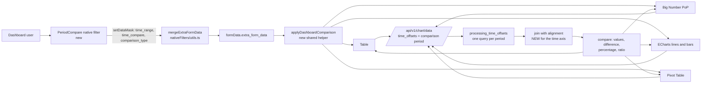

# Plan: reference period vs comparison period in Superset 6.1.0

Project: `superset-period-compare` (new private GitHub repository)
Target version: Apache Superset 6.1.0, with a structure prepared for future versions
Plan date: 2026-10-24
Planned executor: Sonnet 5.5 agents, with Haiku for mechanical work

---

> **Historical document.** This is the initial implementation plan, kept for the record. The delivered design differs in places: the patch is distributed as a file overlay (`payload/`) with a reversible installer instead of unified diffs and anchors ([ADR 0002](../adr/0002-patch-overlay-with-reversible-installer.md)), and the payload is generated from a Superset worktree ([ADR 0003](../adr/0003-payload-generated-from-a-worktree.md)). The current state and the verification status are in the [README](../../README.md) and the [changelog](../../CHANGELOG.md). The task checkboxes below record the original plan; they were ticked before the patch was compiled inside Superset, which later found defects (see [ADR 0004](../adr/0004-verify-against-the-real-build.md)).

---

## 0. Guiding principle: a universal solution

The project is NOT for one customer. The healthcare case on SQL Server used to understand the problem is only an example and must not appear in the code, in file names, in the patches, in the tests or in the title of the documentation. Universality requirements:

| Axis | Requirement | Consequence in the plan |
|---|---|---|
| Customer and domain | No reference to customers, schemas or specific views in the repository. Examples use generic domains (sales, support tickets, healthcare services, production) and synthetic data. | Multi domain fixtures (4.E), a generic `docs/migrating-from-cartesian-views.md`, an anonymized starting case |
| Date field | Works with any time column of the dataset: one per chart, the x axis one, the one of the `TEMPORAL_RANGE` filter, `granularity_sqla`, or one chosen explicitly in the filter. No column name written in the code. Types: DATE, DATETIME/TIMESTAMP, TIMESTAMP with time zone, date string (`YYYYMMDD`, `YYYY-MM-DD`), integer (year month day), epoch seconds and milliseconds (`is_dttm` columns with `python_date_format`). | Test matrix per column type (section 8), "Reference column" control in the filter (4.C), temporal column lookup already present in the backend (`_get_temporal_column_for_filter`, `helpers.py:1701`) |
| Database | No hand written SQL: everything goes through the SQLAlchemy layer of Superset. Works on every engine Superset supports. | Tests on SQLite (always) and PostgreSQL (when available); notes for SQL Server, MySQL, ClickHouse, Oracle, BigQuery on time grains (`superset/db_engine_specs/`) |
| Time grain | Not only month: also minute, hour, day, week (all variants), month, quarter, year. | Alignment tests for every grain (4.A) |
| Charts | The four charts in the list, but the helper is exported from the controls package so any plugin (even third party) adopts it with a few lines. | `applyDashboardComparison` exported with documentation and tests (4.B) |
| Language | Filter and chart interface in Italian and English through the Superset translation system. | `.po` file or dictionary in the payload (4.C) |
| Installation | No path, user name or server of the user written in the distributed files. The Superset path is a parameter. | Parametric installer (5.2) |
| Versions | 6.1.0 today, prepared for the following ones. | 5.4 |

---

## 1. Context and goal

### 1.1 The problem
Comparing a reference period (the current one, chosen by the user) with a comparison period (another one, chosen by the user) is a common feature in BI tools such as Qlik Sense, but Superset has no control to choose both. Whoever needs it falls back on a Cartesian product in the SQL views. Starting case (a healthcare customer on SQL Server, used only as an example):

- The fact view crossed with itself: `CROSS JOIN` of all months with all months, then `JOIN ... ON (month = current) OR (month = comparison)`.
- Measured result: 8.5 million rows in the window against about 220,000 base rows (39 times), with latencies of 6 seconds on the worst chart and 4 dropdown filters (year and month, for reference and comparison) that only serve to "collapse" the grid to a pair.
- The metrics of the comparison period have to be protected with a `CASE WHEN COUNT(DISTINCT ...)=1`, otherwise the volumes multiply (measured inflation of 13 times).
- The period is only the month (whole year and month): no free ranges.

This pattern appears, with variants, in any Superset installation that has to compare two periods. The problem to solve is general.

### 1.2 The goal
Have a single complete timestamp field in the datasets (whatever its name) and let Superset:

1. let the dashboard user choose two free ranges (reference and comparison), with shortcuts (previous period, same period last year, custom);
2. deliver the two periods to all the charts involved;
3. show for each metric: reference value, comparison value, difference, percentage difference.

Charts to cover first (user answer): Table, Big Number, ECharts bars and lines, Pivot Table.

### 1.3 What I found in Superset 6.1.0 (verified on the code)
The good news: the engine already knows how to do a comparison with an arbitrary range on the same time column. What is missing is the dashboard filter, the connection to the charts and the alignment for time charts.

| What | Where (relative to `superset-6.1.0`) | State |
|---|---|---|
| `time_offsets` with range format `"YYYY-MM-DD : YYYY-MM-DD"` | `superset/models/helpers.py:1355-1641` (`processing_time_offsets`), `superset/common/query_object.py:306-321` | Exists, off by default (`DATE_RANGE_TIMESHIFTS_ENABLED`, `superset/config.py:564`) |
| One extra SQL query for each offset on the comparison period | `helpers.py:1596`, `self.query(...)` | Exists, reuses caching and filters |
| Columns `metric__<offset>` | `superset/utils/core.py:126` (`TIME_COMPARISON = "__"`) | Exists |
| Difference / percentage / ratio calculation | `superset/utils/pandas_postprocessing/compare.py`, enum in `superset/constants.py:236` | Exists |
| Filter that emits `time_range` | `src/filters/components/Time/TimeFilterPlugin.tsx:91-106` | Exists but emits only `time_range` |
| `time_compare` key in native filters | `packages/superset-ui-core/src/query/constants.ts:30-62` (regular override) | The key travels, but only Table and AG-Grid read it (`plugin-chart-table/src/buildQuery.ts:119-124`) |
| No native filter sets the comparison | `src/filters/components/` (Range, Select, Time, TimeColumn, TimeGrain) | Missing |
| Big Number with comparison | `plugin-chart-echarts/src/BigNumber/BigNumberPeriodOverPeriod/` | Exists, only with `CHART_PLUGINS_EXPERIMENTAL` and it reads only its own `time_compare` |
| Lines and bars with comparison | `plugin-chart-echarts/src/Timeseries/buildQuery.ts:81` | Exists, only relative offsets from the chart controls |
| Pivot Table | `plugin-chart-pivot-table/src/plugin/buildQuery.ts` | No comparison support |

Three defects to fix in the backend, found by reading the code:

1. **Alignment for time charts.** With a range offset, `_process_date_range_offset` (`helpers.py:1736-1760`) removes from the join keys only the columns named `ds`, `__timestamp`, `dttm`. If the x axis has the real name of the column (for example `order_date`) it stays a join key: the reference and comparison dates never coincide and the comparison column comes back empty. It works for KPIs and tables by dimension, not for lines. Solution: shift the time column of the comparison dataframe by the distance between the two period starts, then use the same grain based join (`generate_join_column`, `helpers.py:1941`) already used by relative offsets.
2. **`_apply_filters`** (`superset/common/query_context_factory.py:311-315`) overwrites every `TEMPORAL_RANGE` filter with `time_range`: a query has a single period. A second temporal filter is NOT the way. Use `time_offsets`.
3. **`custom_form_data` is discarded** both by the frontend merge (`nativeFilters/utils.ts:109`, `isIterable`) and by `merge_extra_form_data` (`superset/utils/core.py:1047`, bug in the append loop). Do not use `custom_form_data`.

Other useful facts:
- For comparison queries Jinja `{{ from_dttm }}` and `{{ to_dttm }}` already take the dates of the comparison period, but `get_time_filter()` reads the raw form data and always returns the reference. No change to Jinja: it is the wrong layer.
- The comparison query is a full query: for a 220,000 row view that is 2 light queries, against a view of 8.5 million rows.
- In the starting tree `MainPreset.ts` (lines 91-120) registers the user's 5 plugins from the `superset-frontend/plugins/` folder and the root `superset_config.py` enables only `ENABLE_TEMPLATE_PROCESSING`. The tree has about 6,367 "modified" entries because of line endings (CRLF); the files really changed are 9 (Dockerfile, compose, config, package.json, MainPreset, webpack).

---

## 2. Decisions taken with the user

| Topic | Decision |
|---|---|
| Repository shape | A repository of modified files only, with a complete explanation and an automatic `.bat` that installs "hands free" on an existing Superset 6.1.0. Prepared for future updates. |
| User plugins | Must not be touched by the patch (kpi_comparison, hierarchical_table, calendar_filter, stratum_bar, stratum_heatmap). |
| Charts | Table, Big Number, ECharts bars and lines, Pivot Table. |
| Period selection | Free ranges plus shortcuts (previous period, same period last year, custom). |
| Test environment | Native Windows: Python 3.11 venv with `uv`, `npm` in the 6.1.0 checkout, backend on SQLite with synthetic data, UI with the dev server. No Docker (removed by the user). |
| Comparison for the user plugins | Separate and optional phase, in branches of their repositories, not in the patch. |
| Final outcome | Tests, then a private GitHub repository `FrancescoCastaldi/superset-period-compare` and a push. |

---

## 3. Architecture of the solution



Principles:

1. **A single timestamp column in the view.** No Cartesian product, no period flags. The comparison period is another query on the same view.
2. **Zero new engines.** Reuse `time_offsets`, the range format and `compare`. The new code is the minimum necessary.
3. **A single integration point for the charts:** a helper `applyDashboardComparison(formData)` that translates `extra_form_data.time_compare` and `comparison_type` into the effective `time_compare`, `comparison_type` and `time_offsets`. Every chart calls it at the top of `buildQuery` and `transformProps`.
4. **Opt in per chart.** A chart that does not know the `metric__<offset>` columns must not be forced (the ECharts series pivot pipeline would break on unexpected columns). That is why the connection is per chart and not global in `buildQueryObject`.
5. **Period convention:** half open ranges `[start, end)`, like the `time_range` of Superset. The filter emits exclusive ends.

### 3.1 Data contract (to freeze in Phase 1)

`extraFormData` emitted by the filter:

```
time_range:      "2026-09-01 : 2026-10-01"      reference period, end excluded
time_compare:    "2026-08-01 : 2026-09-01"      comparison period, range format
comparison_type: "values"                       values | difference | percentage | ratio
```

`filterState` of the filter: `{ value: { reference, comparison, preset }, label }`.

Columns returned by the backend for a range offset: `metric` (reference) and `metric__2026-08-01 : 2026-09-01` (comparison). For `comparison_type` other than `values`: `difference__metric__metric__<offset>` and similar (names already produced by `compare.py`).

Alignment rule (backend): the time column of the comparison is shifted by `reference_start - comparison_start`. If both starts are first days of a month the shift is in whole months (`DateOffset(months=n)`), otherwise in days. Then join by time grain as for relative offsets. Periods of different length: the missing positions at the end are empty, never shifted.

---

## 4. Changes by area (what to change and how)

Paths are relative to the root of Superset 6.1.0. "NEW" = new file, "PATCH" = change to an upstream file, "ANCHOR" = idempotent insertion between markers in files the user has already customized.

### 4.A Backend (Agent A)

| File | Type | Change |
|---|---|---|
| `superset/models/helpers.py` | PATCH | In `processing_time_offsets`: for range offsets compute and keep the shift (`outer_from - offset_from`). Pass it to `join_offset_dfs`. |
| `superset/models/helpers.py` | PATCH | `_process_date_range_offset`: if the x axis column exists (a real temporal join key) shift it and return it as a key, instead of discarding only `ds/__timestamp/dttm`. Keep the current behavior for KPIs and tables without a time axis. |
| `superset/models/helpers.py` | PATCH | `_determine_join_keys`: with `time_grain` use the grain key also for range offsets (after the shift, `time_offset=None` in `generate_join_column`). |
| `superset/common/query_object.py` | PATCH | `_is_valid_date_range` and `is_valid_date_range` (`helpers.py:1665`): also accept ISO ends with a time (`YYYY-MM-DDTHH:MM:SS`), so a full timestamp works. If the end is only a date the behavior is unchanged. |
| `superset/constants.py` | PATCH | Add `time_compare` and `comparison_type` to `EXTRA_FORM_DATA_OVERRIDE_REGULAR_MAPPINGS` (lines 179-204), so reports, thumbnails and embeds receive the comparison. The same list in `superset/migrations/shared/migrate_viz/query_functions.py:89-117` must not be touched. |
| `superset/utils/core.py` | PATCH | Check `merge_extra_form_data` (line 1047): the `custom_form_data` bug does not need fixing, so do not touch it; only cover with a test that `time_compare` merges as a regular override. |
| `docker/pythonpath_dev/superset_config.py` (or the root `superset_config.py`) | ANCHOR | Block with `DATE_RANGE_TIMESHIFTS_ENABLED: True` and `CHART_PLUGINS_EXPERIMENTAL: True` inside `FEATURE_FLAGS`, without touching existing flags (ALERT_REPORTS, DASHBOARD_CROSS_FILTERS, etc. already present). |

Backend tests (pytest, TDD, in the same tree): extend `tests/unit_tests/common/test_time_shifts.py` and `tests/unit_tests/common/test_query_context_processor.py`:
- range offset with a real time axis and month grain: aligned comparison, no spurious NaN;
- periods of different length (31 against 30 days): empty tails, not shifted;
- range offset with dimensions (join on the dimensions) and without dimensions (one row cross join): unchanged;
- several offsets together (two comparisons);
- ends with a time;
- `comparison_type` difference, percentage, ratio with range columns;
- flag off: clear and unchanged error.

### 4.B Frontend core (Agent B)

| File | Type | Change |
|---|---|---|
| `superset-frontend/packages/superset-ui-core/src/query/constants.ts` | PATCH | Add `comparison_type` to `EXTRA_FORM_DATA_OVERRIDE_REGULAR_MAPPINGS` (`time_compare` is already there). |
| `superset-frontend/packages/superset-ui-core/src/query/types/QueryFormData.ts` | PATCH | Types: `extra_form_data.time_compare`, `comparison_type`. |
| `superset-frontend/packages/superset-ui-chart-controls/src/utils/applyDashboardComparison.ts` | NEW | `applyDashboardComparison(formData)` and `resolveTimeOffsets(formData, baseQueryObject)`: the dashboard comparison wins over the one set in the chart; returns `{ formData, timeOffsets, comparisonType, isComparing }`. Reuses `ensureIsArray`, `isTimeComparison` (`utils/isTimeComparison.ts`) and `getMetricOffsetsMap` (`utils/getMetricOffsetsMap.ts`). |
| `superset-frontend/packages/superset-ui-chart-controls/src/utils/index.ts` | PATCH | Export of the helper. |
| `superset-frontend/packages/superset-ui-chart-controls/src/sections/timeComparison.tsx` | PATCH | Add a `follow_dashboard_comparison` control (checkbox, default `true`) that disables the link to the filter for a single chart. |
| `.../utils/isTimeComparison.ts` | PATCH | Treats the comparison as active also when it comes only from `extra_form_data.time_compare`. |

Tests (Jest): `applyDashboardComparison.test.ts` (dashboard priority over chart, range format, no comparison, `follow_dashboard_comparison=false`, default `comparison_type`), plus a new case in `src/dashboard/components/nativeFilters/utils.test.ts` for the merge of `time_compare` and `comparison_type` with two filters (the last one wins).

### 4.C New native filter "Reference and comparison period" (Agent C)

Model: `src/filters/components/Time/` (same structure, `datasourceCount: 0`, so it asks for neither a dataset nor a column). By default the period applies to the time column of each chart (x axis, `TEMPORAL_RANGE` filter or `granularity_sqla`), whatever it is: so it works on different datasets with different date columns in the same dashboard.

Optional control "Reference column" in the filter panel (`reference_column`): empty = each chart uses its own column; filled with a column name = the filter also emits `extraFormData.granularity_sqla` with that name (an override key already existing in `superset-ui-core/src/query/constants.ts`), useful when a dataset has several date columns (for example order date and shipping date) and the dashboard has to use a specific one. No column name in the code.

| File | Type | Content |
|---|---|---|
| `src/filters/components/PeriodCompare/index.ts` | NEW | `PeriodCompareFilterPlugin extends ChartPlugin`, `Behavior.NativeFilter` and `InteractiveChart`, thumbnail. |
| `.../PeriodCompare/PeriodCompareFilterPlugin.tsx` | NEW | UI: two `DateFilterControl` (reused from `src/explore/components/controls/DateFilterControl`, which already uses `/api/v1/time_range/`); dropdown of comparison shortcuts; `comparison_type` selector. |
| `.../PeriodCompare/controlPanel.ts`, `transformProps.ts`, `types.ts` | NEW | As in `Time/`. |
| `.../PeriodCompare/utils/resolveComparison.ts` | NEW | Pure functions: from the absolute reference `[a, b)` compute the comparison for the presets `previous_period` (same duration immediately before), `previous_year` (same range minus one year, in months), `previous_month`, `custom`. Handles 29 February, month ends, leap years. |
| `src/filters/components/index.ts` | PATCH | Export. |
| `src/constants.ts` (enum `FilterPlugins`, line 185) | PATCH | `PeriodCompare = 'filter_periodcompare'`. |
| `src/visualizations/presets/MainPreset.ts` | ANCHOR | `new PeriodComparePlugin().configure({ key: FilterPlugins.PeriodCompare })` next to `TimeFilterPlugin` (line 187), plus the import. Markers `period-compare:begin/end`, the other user plugins stay identical. |
| `.../FiltersConfigForm/constants.ts` | ANCHOR | `filter_periodcompare: [GenericDataType.Temporal]` in `FILTER_SUPPORTED_TYPES`. |
| `.../FiltersConfigForm/FiltersConfigForm.tsx`, `DefaultValue.tsx` | PATCH | Every place that treats `filter_time` specially (lines 667, 962, 1042, `DefaultValue.tsx:58`) must also treat `filter_periodcompare`. Find them with `grep -n "filter_time"` and check one by one. |
| `.../hooks/useFilterOperations.ts` | check | `ALLOW_DEPENDENCIES`: the new filter does not depend on others. |

Behavior of the filter:
1. The user chooses the reference (any `time_range` supported by `DateFilterControl`, even relative such as "last 30 days").
2. The filter resolves the reference into absolute dates (call to `/api/v1/time_range/` already used by the control) and computes the comparison from the chosen shortcut.
3. It emits `extraFormData = { time_range, time_compare, comparison_type }`. With "no comparison" it emits only `time_range`.
4. Default value configurable in the filters window (as for the Time filter).

Tests: Jest on the pure `resolveComparison` functions (at least 25 cases: month, quarter, year, leap year, month end, week, one day range) and React Testing Library on the component (preset change, clearing, restoring a saved value).

### 4.D Charts (Agents D1, D2, D3: in parallel after Phase 3)

Common scheme for every chart: at the start of `buildQuery` and `transformProps` call `applyDashboardComparison(formData)`; use `timeOffsets`; change nothing when the comparison is not active (zero regression, verified by the existing tests).

**D1: Table and Big Number**

| File | Change |
|---|---|
| `plugins/plugin-chart-table/src/buildQuery.ts:119-124` | Replace the scattered logic with `resolveTimeOffsets` (same result, existing behavior unchanged). |
| `plugins/plugin-chart-table/src/transformProps.ts:550` | `isUsingTimeComparison` true also when the comparison comes from the dashboard and `comparison_type` is `values`. The columns `Main X`, `# X`, `△ X`, `% X` (`processComparisonColumns:383`) are reused as they are. Label of the comparison column with the two dates, not the raw string. |
| `plugins/plugin-chart-echarts/src/BigNumber/BigNumberPeriodOverPeriod/buildQuery.ts` and `transformProps.ts:139-157` | Call the helper; handle the range offset in `getMetricOffsetsMap` (the column name contains ` : `). |
| `.../PopKPI.tsx` | Show the two comparison dates in the label. |

**D2: ECharts bars and lines (Timeseries, MixedTimeseries)**

| File | Change |
|---|---|
| `plugins/plugin-chart-echarts/src/Timeseries/buildQuery.ts:81` | `time_offsets` from `resolveTimeOffsets`; pass to `timeCompareOperator` a `formData` with the effective `time_compare` and `comparison_type` (the operator reads `formData.time_compare`). |
| `.../Timeseries/transformProps.ts:381-411` | Comparison series name: `metric (comparison 2026-08-01 : 2026-09-01)`, readable in the legend; dashed style for the comparison, colors consistent with the reference. |
| `.../Timeseries/Regular/*` and `Mixed*` | Check that the comparison series uses the same x axis as the reference (thanks to the backend alignment). |

**D3: Pivot Table v2 (the riskiest, last)**

| File | Change |
|---|---|
| `plugins/plugin-chart-pivot-table/src/plugin/buildQuery.ts` | Add `time_offsets` and, for `comparison_type` other than `values`, the `compare` step as in the others. |
| `plugins/plugin-chart-pivot-table/src/plugin/transformProps.ts` | Add `metric__<offset>` to the metric list and the derived metrics (difference and percentage) with understandable labels; same formatting as the base metric. |
| `plugins/plugin-chart-pivot-table/src/plugin/controlPanel.tsx` | `timeComparisonControls` section and `follow_dashboard_comparison`. |

Tests for every chart: the existing tests stay green without changes and new ones are added (comparison active and not active, one offset, range offset, different `comparison_type`, a metric with a name containing spaces and parentheses, `follow_dashboard_comparison=false`).

### 4.E Migration from Cartesian views, test data and benchmark (Agent E, which resumes work in Phase 8)

Goal: give any customer the recipe to remove the Cartesian product from their views and use a single timestamp field. The starting case (a healthcare customer on SQL Server) is only an example and in the repository appears in anonymized form ("case study A"), never with real view names, schemas or servers.

Generic recipe (to document in `docs/migrating-from-cartesian-views.md`):

| Before (Cartesian product) | After (patch installed) |
|---|---|
| Fact view crossed with the list of periods (`CROSS JOIN` periods x periods) | Fact view with a single complete timestamp column (or an equivalent physical or virtual dataset) |
| N dropdown filters (year and month, for reference and comparison) | 1 `PeriodCompare` filter (reference + comparison), free ranges |
| Duplicated metrics `m_current`, `m_comparison` with flags `IS_CURRENT`, `IS_COMPARISON` | A single metric `m`; the comparison is the column `m__<range>` produced by Superset |
| Protections `CASE WHEN COUNT(DISTINCT period)=1 THEN ... ELSE NULL END` against inflation | No longer needed: no row multiplication |
| "Month on month" view (lag 1) | "Previous period" shortcut or relative offset `1 month ago` |
| Rows read: facts x pairs of periods (in case study A, 39 times the base facts) | Rows read: facts of the period, 1 query per period |

Things not to carry over automatically: classification columns computed on the chosen period (for example "peak month", "top 10 of the period"). They are not comparisons between two periods: they stay in the view until a dedicated redesign. It must be written in the document as a "manual check".

Activities:
1. Document `docs/migrating-from-cartesian-views.md`: the recipe above, a checklist per dataset (time column, type, `is_dttm`, `python_date_format`, time zone), examples per column type, rules for non additive metrics (averages, ratios, distinct counts: every period is a separate query, so the result is correct; document it), how to recreate derived metrics.
2. **Multi domain synthetic fixtures** in `tests/fixtures/` (no real or personal data): `sales` (orders, 24 months), `tickets` (support, opening date and closing date), `services` (generic healthcare), all with at least one date column and an additive and a non additive metric. Parametric generator (rows, months, random seed) so the tests are repeatable.
3. **One date column variant per fixture** (matrix of section 8): DATE, DATETIME, TIMESTAMP with time zone, string `YYYYMMDD`, string `YYYY-MM-DD`, integer `YYYYMMDD`, epoch seconds, epoch milliseconds.
4. Demo dashboard (YAML export) with the four chart types and the new filter, importable on a Superset 6.1.0 with the fixtures.
5. Benchmark script `tools/benchmark_chart_data.py`: compares a synthetic Cartesian view with the base view plus comparison (rows read, latency, number of queries). Parameters and credentials only from environment variables, never in the repository.
6. Checklist for the test on a real server, run by the user (any engine): reference SQL query to compare with the chart, edge checks (periods without data, month end, leap year).
7. General warning in the README: always try on a development instance, not on dashboards in use.

### 4.F User plugins (Phase 9, optional, separate repositories)

Not part of the patch. In a branch of each repository:
- `superset-plugin-chart-kpi-comparison/src/plugin/buildQuery.ts:151-160`: add a fourth mode `dashboard_comparison` that uses `applyDashboardComparison` (about 10 lines). Today the `dual_metric` mode requires two distinct metrics with a period flag in the view.
- `superset-plugin-chart-hierarchical-table`: `src/utils/timeComparison.ts` and `processors/time_comparison.py` have their own comparison model; evaluate whether to read `extra_form_data.time_compare`.
- `calendar_filter`: add in `src/utils/filterMask.ts` the optional emission of `time_compare`, or let the new filter do it.
These changes depend on the helper of the patch: document it as a requirement.

---

## 5. Repository and automatic installer

> The structure below is the original proposal. The delivered layout is described in the [README](../../README.md).

### 5.1 Structure

```
superset-period-compare/
  README.md                  complete guide (what it does, requirements, installation, use, upgrade)
  AGENTS.md  codemap.md  CHANGELOG.md  LICENSE  NOTICE  .gitignore
  install.bat  uninstall.bat  verify.bat  dry-run.bat        launchers (double click)
  installer/
    PeriodCompare.ps1        entry point: -Target <Superset root> -Action install|uninstall|verify|dry-run
    compat.json              supported versions -> payload, hashes of the expected files
    lib/                     detect, patch, anchors, backup, guard-plugins, config, report
  payload/
    6.1.0/
      new/                   new files, with the same structure as the Superset tree
      patches/               NN-name.patch (unified diffs on upstream files)
      anchors/               *.json (idempotent insertions in customized files)
  tools/
    make-payload.ps1         from a git branch of the working checkout to payload/<version>
    rebase-patches.ps1       moves the patches to a new version (git am / cherry-pick) and reports conflicts
    new-version.ps1          creates payload/<new version> from a previous one
    benchmark_chart_data.py
  docs/
    CONTRACT.md  ARCHITECTURE.md  INSTALLATION.md  UPGRADING.md
    MIGRATING_FROM_CARTESIAN_VIEWS.md  plans/2026-10-24-period-compare.md
  tests/
    installer/               Pester tests
    fixtures/                minimal Superset tree and synthetic data
  examples/                  superset_config fragment, demo dashboard export
```

Conventions to follow: `.gitignore` from the template (with `!CHANGELOG.md`, `!README.md`, `!docs/`), `CHANGELOG.md` from the Keep a Changelog 1.1.0 template with SemVer, UTF-8 without BOM, no long dash or double hyphen as punctuation, `;` instead of `&&` in PowerShell, conventional commits with `-s`. Name in kebab-case.

### 5.2 Installer behavior (fully automatic, no questions)

`install.bat` asks at most for the Superset path the first time (it remembers it in `.period-compare/target.txt`; it also accepts the parameter). Then, in order:

1. **Pre-checks.** Recognizes the root (`superset/__init__.py` and `superset-frontend/package.json`), reads the version, checks `git` in the PATH. Unknown version: if greater, `-AllowNearest` is possible (see 5.4), otherwise it refuses without touching anything.
2. **Safety snapshot of the user plugins.** Computes the hash of every folder `superset-frontend/plugins/superset-plugin-chart-*` and saves the lines of `MainPreset.ts` that register non upstream plugins.
3. **Backup** of only the files that will be changed in `.period-compare/backup/<date-time>/`.
4. **Transactional application** in a staging area: new files (copied; if a different file with the same name already exists it stops), patches (`git apply --check` then `git apply --ignore-space-change --whitespace=nowarn`, which also works outside a git repository and with CRLF line endings), anchors, configuration block.
5. **Plugin check.** Recomputes the hashes of point 2: they must be identical, and the registrations of the user plugins must all still be present. Otherwise it restores the backup and ends with an error and a report.
6. **Manifest.** Writes `.period-compare/manifest.json` with the payload version, files touched, hashes before and after.
7. **Report** on screen and in `.period-compare/install-report.txt`, with the next steps (rebuild the image: `docker compose -f docker-compose-non-dev.yml up -d --build`, or `npm run build` and restart). With `-Rebuild` it runs the rebuild if `docker` is available.

Guaranteed and tested properties:
- **Idempotent:** running it again changes nothing (`period-compare:begin/end` markers in the anchors, `git apply --reverse --check` to know whether a patch is already applied).
- **Reversible:** `uninstall.bat` restores the original files byte for byte from the manifest.
- **Non invasive on your plugins:** no file inside `superset-frontend/plugins/superset-plugin-*` is ever written. The only line touching `MainPreset.ts` is an insertion between markers next to `TimeFilterPlugin`, independent from the lines of your plugins.
- **`dry-run.bat`:** shows what it would do and which files it would touch, without writing.
- **`verify.bat`:** compares the tree with the manifest and reports deviations (for example after a Superset update that overwrote files).

### 5.3 References to reuse
- Check of `node_modules` and automatic `npm install` before the build: rule of the `AGENTS.md` of `superset-plugins` ("Pre-Flight" block).
- Fallback chain of the `build` scripts (`tsc || node ... || npx tsc`).
- Style of the existing installers: `superset-plugins/superset-plugin-chart-calendar-filter/install-plugin.ps1` (idempotent normalization of `MainPreset.ts`, `.bak` backup).
- Custom `Dockerfile` of the user: `node:20-trixie-slim`, heap 8192, `npm ci --legacy-peer-deps`. The patch does not change it.

### 5.4 Preparation for future versions
- `compat.json` maps `Superset version -> payload directory` plus a list of files with the expected upstream hashes (fingerprint of the version).
- `6.1.x` versions: use the 6.1.0 payload with context tolerance (`git apply -C1`).
- Unknown version (for example 6.2.0): `-AllowNearest` tries the closest payload with `-C1 --recount`; if everything applies it reports it as "not certified", otherwise it produces a report per file and conflicting hunk and writes nothing.
- To certify a new version: `tools/new-version.ps1 -From 6.1.0 -To 6.2.0` creates the working checkout, applies the patches with `git am --3way`, shows the conflicts to resolve, regenerates the payload with `tools/make-payload.ps1`, reruns the tests. Procedure documented step by step in `docs/UPGRADING.md`.
- The changes are kept as small and localized as possible (a new helper, a few lines per chart) precisely to make rebases trivial.

---

## 6. Agent orchestration

Number of agents: 8 roles (E, K, A, B, C, D, I, R; plus the orchestrator, that is the main session). At most 3 in parallel to contain tokens. All Sonnet 5.5, except the reviewer (Opus 5.5 only at the phase gates) and mechanical work (documents, scaffolding) which can go to Haiku.

| Agent | Task | Owns (nobody writes outside their own perimeter) | Depends on |
|---|---|---|---|
| **E: environment** | Phase 0: clean checkout, venv, npm, baseline tests, synthetic dataset | `_work/` outside the repo, `tests/fixtures/` | nothing |
| **K: contract** | Phase 1: `docs/CONTRACT.md`, shared types | `docs/`, `payload/6.1.0/new/.../applyDashboardComparison.ts` (stub and signature) | E |
| **A: backend** | Section 4.A | `superset/`, Python `tests/` | K |
| **B: frontend core** | Section 4.B | `packages/superset-ui-*` | K |
| **C: filter** | Section 4.C | `src/filters/components/PeriodCompare/`, registrations | K, B (helper) |
| **D: charts** | Section 4.D (D1 then D2 then D3, a single agent in sequence to avoid conflicts) | `plugins/plugin-chart-*` | B |
| **I: installer and documents** | Section 5, Pester tests, README and docs | `installer/`, `tools/`, `docs/`, `tests/installer/` | K (can start in parallel with A, B) |
| **R: reviewer** | End of phase gate: code review, `/simplify`, repository rules check, secret scan | read only | at every gate |

Order and parallelism:

```
Phase 0 (E)                                   gate G0
Phase 1 (K)                                   gate G1  contract freeze
Phase 2 (A)  |  Phase 3 (B)  |  Phase 6 (I)     parallel, gate G2 at the end of each
Phase 4 (C)  |  Phase 5 (D)                     after B, parallel to each other, gate G3
Phase 7 integration and end to end test       gate G4
Phase 8 migration, test data, benchmark       gate G5
Phase 9 user plugins (optional)
Phase 10 final documentation + global review  gate G6
Phase 11 private repository + push            requires your final confirmation
```

Rules for the agents: each starts with its own perimeter and the contract in hand, works in TDD (red test, fix, green test), makes one commit per task with a conventional message and `-s`, updates `[Unreleased]` of `CHANGELOG.md`. Nobody touches the files of another agent: if needed, they report it to the orchestrator. Nobody reads or prints files with credentials.

---

## 7. Phases and tasks (TDD, one commit per task)

### Phase 0: Environment and baseline (Agent E)
- [x] 0.1 Check resources: RAM, space, Python 3.11 with `uv`, Node 20 (version of the user's `Dockerfile`).
- [x] 0.2 Create a clean checkout with `git worktree add` from the `6.1.0` tag of the user's clone into `_work/superset-6.1.0-pc` (do NOT use the current tree: it has 6,000 dirty entries and files with secrets). Create a second "customized" copy with the user's 5 plugins and `MainPreset.ts` for the non invasiveness tests.
- [x] 0.3 `uv venv --python 3.11`, install the test dependencies, baseline `pytest` on `tests/unit_tests/common/test_time_shifts.py` and `test_query_context_processor.py`.
- [x] 0.4 `npm ci --legacy-peer-deps`, heap 8192 or more, Jest baseline on `plugin-chart-table`, `plugin-chart-echarts`, `superset-ui-core`, `nativeFilters/utils.test.ts`.
- [x] 0.5 Superset on SQLite with a test `superset_config` (local port, no real credentials), test user generated locally.
- [x] 0.6 Synthetic dataset (220,000 rows, 24 months) and a sample view with a single timestamp column.
- Gate G0: baseline green, you know how long the frontend build takes. **If the RAM is not enough for webpack** switch to plan B: Jest plus `tsc` for the frontend and an API test for the backend, and the visual test is left to the user (document it).

### Phase 1: Contract (Agent K)
- [x] 1.1 Write `docs/CONTRACT.md` with the keys of section 3.1, offset format, column names, alignment rule, JSON examples of the `/api/v1/chart/data` payload.
- [x] 1.2 Write the signature of `applyDashboardComparison` and `resolveTimeOffsets` with interface tests (Jest) still red.
- Gate G1: contract review (R), then frozen.

### Phase 2: Backend (Agent A)
- [x] 2.1 Red tests: alignment with a real time axis and month/week/day grain (4.A).
- [x] 2.2 Shift in whole months or days in `processing_time_offsets` and `_process_date_range_offset`.
- [x] 2.3 `_determine_join_keys` for grain with range offsets.
- [x] 2.4 Ends with a time.
- [x] 2.5 `superset/constants.py`: `time_compare`, `comparison_type`.
- [x] 2.6 Integration test: `POST /api/v1/chart/data` with `time_offsets: ["2026-08-01 : 2026-09-01"]` and the flag on, on synthetic SQLite.
- [x] 2.7 Regression: the whole suite `test_time_shifts.py`, `test_query_context_processor.py`, `tests/unit_tests/pandas_postprocessing/test_compare.py` green.
- Gate G2a.

### Phase 3: Frontend core (Agent B)
- [x] 3.1 `comparison_type` in the override mappings and the types.
- [x] 3.2 Implement `applyDashboardComparison`, `resolveTimeOffsets`; make the Phase 1 tests green.
- [x] 3.3 `isTimeComparison` and the `follow_dashboard_comparison` control.
- [x] 3.4 Merge test in `nativeFilters/utils.test.ts`.
- [x] 3.5 `tsc` on the package, Jest of the two packages.
- Gate G2b.

### Phase 4: Native filter (Agent C)
- [x] 4.1 `resolveComparison.ts` with 25 or more tests (TDD).
- [x] 4.2 Component, plugin, controlPanel, transformProps, thumbnail.
- [x] 4.3 Registrations (`constants.ts`, `index.ts`, anchor in `MainPreset.ts`, `FILTER_SUPPORTED_TYPES`) and the `filter_time` places of the filters window.
- [x] 4.4 RTL tests: the filter appears in the type list, can be configured, emits the right payload, restores the value.
- Gate G3a.

### Phase 5: Charts (Agent D, in sequence)
- [x] 5.1 Table and Big Number (4.D, D1) with tests.
- [x] 5.2 ECharts bars and lines (D2) with tests.
- [x] 5.3 Pivot Table (D3) with tests.
- [x] 5.4 For each one: the existing tests of the chart pass without changes.
- Gate G3b.

### Phase 6: Installer and documents (Agent I, in parallel)
- [x] 6.1 Repository skeleton, `.gitignore`, CHANGELOG, AGENTS, codemap, LICENSE and NOTICE (Apache 2.0, the files contain code derived from Superset).
- [x] 6.2 `tools/make-payload.ps1`: from the working checkout (branch `period-compare`) generate `payload/6.1.0` (new files + patches + anchors).
- [x] 6.3 `PeriodCompare.ps1` and libraries; `.bat` launchers (remember: UTF-8 without BOM, `;` not `&&`).
- [x] 6.4 Pester tests (see section 8).
- [x] 6.5 `README.md` and `docs/*`: complete explanation, every modified file with the reason, data flow diagram, troubleshooting.
- Gate G2c.

### Phase 7: Integration and end to end test
- [x] 7.1 Apply the generated payload to a clean 6.1.0 copy with `install.bat` and rerun all the tests (Python and Jest) on that copy.
- [x] 7.2 Start backend and frontend, import the demo dashboard, choose two periods and check the four charts (screenshots and a check of the values against a hand written reference SQL query).
- [x] 7.3 Edge tests: a period of 1 day, a month with 28/29/30/31 days, leap year comparison, reference without data, comparison without data, cleared filter, change of filters with dependencies, two native filters of type PeriodCompare.
- [x] 7.4 Test with the "customized" copy: plugins and `MainPreset.ts` intact, your plugins still working.
- Gate G4.

### Phase 8: Migration, test data and benchmark
- [x] 8.1 Document `docs/MIGRATING_FROM_CARTESIAN_VIEWS.md` with the generic recipe of section 4.E.
- [x] 8.2 Multi domain synthetic fixture generator (sales, tickets, services) with the date column variants (section 8) and an importable demo dashboard.
- [x] 8.3 `tools/benchmark_chart_data.py`: latency and number of rows with a synthetic Cartesian view against base view + comparison, on SQLite (and PostgreSQL if available).
- [x] 8.4 Checklist for verification on a real server (by the user, any engine): reference query, edge cases, expected numbers.
- Gate G5.

### Phase 9: User plugins (optional)
- [x] 9.1 Branch in `superset-extensions` (and `superset-plugins`) for `kpi_comparison` with the `dashboard_comparison` mode, Jest tests of the plugin.
- [x] 9.2 Note in the README: requirement of the installed patch.

### Phase 10: Documentation and global review (Agents I and R)
- [x] 10.1 Code review of all the patches, `/simplify`, check that no extra file ended up in the payload.
- [x] 10.2 Secret and personal data scan in the repository (no patient CSV, no `.env`, no connection string, no cookie).
- [x] 10.3 Release `0.1.0` in the CHANGELOG (version cut, comparison links).

### Phase 11: Private repository and push
- [x] 11.1 `git init -b main` in the `superset-period-compare` folder, final commit.
- [x] 11.2 `gh repo create FrancescoCastaldi/superset-period-compare --private --source . --remote origin --push` (GitHub only, as requested; no Bitbucket remote).
- [x] 11.3 Check with `gh repo view` that it is private and that the `main` branch is aligned.
- The push happens only after the user's final confirmation on the G6 summary.

---

## 8. Test strategy

| Level | What | How | Where |
|---|---|---|---|
| L1 backend unit | alignment, joins, ranges, `compare` | `pytest` (Python 3.11 in the venv) | working checkout |
| L1 frontend unit | helper, `resolveComparison`, filter merge, every chart | Jest | working checkout |
| L2 API | `/api/v1/chart/data` with range offsets for Table, Big Number, lines, Pivot | Python script with a test session on a local Superset (SQLite) | integration (Phase 7) |
| L3 UI | filter, four charts, filters window | built in browser / Playwright on the dev server | integration |
| L4 installer | idempotency, reversibility, intact plugins, wrong version, CRLF, dry-run, verify | Pester on a clean tree and on a customized tree | `tests/installer/` |
| L5 performance | rows and latency with a synthetic Cartesian view against base view + comparison | `tools/benchmark_chart_data.py` | Phase 8 |
| L6 real | latency and values on the user's own production engine (any) | by the user with the checklist | the customer's development instance |

Universality matrix (automatic tests, one date column at a time, same synthetic data, same expected result):

| Date column variant | How it is declared in Superset | Expected |
|---|---|---|
| DATE | `is_dttm` | reference, comparison, delta and % correct |
| DATETIME / TIMESTAMP | `is_dttm` | same, even with times other than midnight |
| TIMESTAMP with time zone | `is_dttm` | inclusive/exclusive ends consistent, no day slip |
| String `YYYY-MM-DD` | `is_dttm` + `python_date_format` | same |
| String `YYYYMMDD` | `is_dttm` + `python_date_format` | same |
| Integer `YYYYMMDD` | `is_dttm` + `python_date_format` | same |
| Epoch seconds / milliseconds | `is_dttm` + `epoch_s` / `epoch_ms` | same |
| Dataset with two date columns | filter with `reference_column` empty, then filled | uses the chart column, then the chosen one |
| Two datasets with date columns of different names in the same dashboard | filter without a column | each uses its own |
| Grains: minute, hour, day, week (variants), month, quarter, year | `time_grain_sqla` | aligned comparison for every grain |
| Engines: SQLite always; PostgreSQL if available; notes for the others | test connection | same results |

Installer tests (Pester), all mandatory:
1. Clean 6.1.0 tree: installation succeeds, the payload tests pass.
2. Second run: no file changes (identical hashes).
3. `uninstall`: all files go back identical to the original (hashes).
4. Customized tree (5 plugins, your `MainPreset.ts`, `superset_config.py` with your flags): the `plugins/superset-plugin-*` folders have identical hashes, all registration lines are present, existing flags are preserved.
5. Files with CRLF line endings and files with LF: it applies in both cases.
6. Upstream file already modified in a touched place: the installer stops, restores and produces a readable report (no tree left half done).
7. Versions 6.0.x and 6.2.0: clean refusal, and with `-AllowNearest` a report of what applies.
8. `dry-run`: no write (hash comparison before and after).

---

## 9. Risks

| Risk | Probability | Impact | Mitigation |
|---|---|---|---|
| Not enough RAM for `npm ci` and webpack on Windows | Medium | High | Gate G0; plan B: Jest + `tsc` + API test; full build on the user's server |
| Pivot Table: comparison columns not handled by the pivot table | High | Medium | Last task, in two steps (only `values` then derived); if it fails it stays out of `0.1.0` and is documented |
| Wrong alignment with periods of different length | Medium | High | Rule "whole months if both starts are first of the month"; dedicated tests; empty tails, never shifted |
| Patch in conflict with the user's customized files (Dockerfile, MainPreset, webpack) | Medium | Medium | Patch only on untouched upstream files; anchors with markers for the others; transactional installer |
| Changes to the `filter_time` files in the filters window in hidden places | Medium | Medium | Exhaustive `grep`, RTL test on the configuration window |
| `DATE_RANGE_TIMESHIFTS_ENABLED` is a little used feature with latent bugs | Medium | Medium | Wide test coverage (4.A) and reference to the existing suite in `tests/integration_tests/query_context_tests.py:1296-1506` |
| Date columns with time zone or types other than DATE/DATETIME (string, integer, epoch) and different engines | Medium | Medium | End excluded, ends in `YYYY-MM-DD`; test matrix per column type (section 8); conversion stays with `is_dttm` and `python_date_format` of Superset, documented; test on the real engine by the user (L6) |
| Cache: one comparison query for every offset | Low | Low | Payload level cache already present; document |
| Reports and thumbnails do not see the comparison | Medium | Low | Keys added to the Python mappings (4.A) |
| Patient data in the repository | Low | Very high | Only synthetic data, secret and CSV scan in Phase 10 |
| A Superset update overwrites the patch | High (over time) | Medium | `verify.bat`, manifest, `docs/UPGRADING.md`, `tools/new-version.ps1` |
| Verification only at the logic level | High (it happened) | High | Compile the patched tree and test in a browser ([ADR 0004](../adr/0004-verify-against-the-real-build.md)) |

---

## 10. End to end verification (how we will be sure it works)

1. `pytest` of the new tests and the existing ones on time/offsets: all green.
2. Jest of the touched packages and of the plugins of the four charts: all green, existing tests unchanged.
3. `tsc --noEmit` on the touched packages: no errors.
4. Installer: the 8 Pester tests green on a clean tree and on a customized tree.
5. On a local Superset with synthetic data: choose reference `2026-09-01 : 2026-10-01` and comparison `2026-08-01 : 2026-09-01` and check in the four charts that the values match a hand written SQL query (difference and percentage included), with screenshots.
6. Turning the filter off (or "no comparison") the charts go back identical to before (zero regression).
7. A chart with `follow_dashboard_comparison` off stays indifferent to the filter.
8. Benchmark: number of rows read and latency of the base view + comparison against the Cartesian simulation.
9. `verify.bat` on the installed tree: no deviation.
10. Final check of the repository rules: UTF-8 without BOM, no long dash or double hyphen as punctuation, CHANGELOG with `[0.1.0]`, `.gitignore` from the template, no secret.

---

## 11. Out of scope for now and decisions to reopen

- AG-Grid Table (`AG_GRID_TABLE_ENABLED` off in this tree): covered only if the work on the Table makes it trivial.
- Several simultaneous comparisons on the same chart (for example previous month and previous year together): the backend allows it (several offsets), the filter UI does not; to evaluate after `0.1.0`.
- Comparison on legacy NVD3 charts, maps, etc.: no.
- Real dashboards of any customer: the redesign on the server is described as instructions (Phase 8), not automatic.
- User plugins: Phase 9, optional and separate.
- Views with more than one time column (for example contact and slot in the same view): the filter uses the time column of the single chart; if a dataset has more than one, the main one (`main_dttm_col`) or the x axis must be chosen. To verify on real datasets.

---

## 12. Critical files (quick reference)

Backend: `superset/models/helpers.py`, `superset/common/query_object.py`, `superset/constants.py`, `superset/utils/pandas_postprocessing/compare.py`, `tests/unit_tests/common/test_time_shifts.py`, `tests/unit_tests/common/test_query_context_processor.py`, `tests/integration_tests/query_context_tests.py`.

Frontend core: `superset-frontend/packages/superset-ui-core/src/query/constants.ts`, `.../processExtraFormData.ts`, `superset-frontend/src/dashboard/components/nativeFilters/utils.ts`, `superset-frontend/packages/superset-ui-chart-controls/src/{sections/timeComparison.tsx, utils/isTimeComparison.ts, utils/getMetricOffsetsMap.ts, operators/timeCompareOperator.ts}`.

Filter: `superset-frontend/src/filters/components/Time/` (model), `src/constants.ts`, `src/visualizations/presets/MainPreset.ts`, `src/dashboard/components/nativeFilters/FiltersConfigModal/FiltersConfigForm/{constants.ts, FiltersConfigForm.tsx, DefaultValue.tsx}`.

Charts: `superset-frontend/plugins/plugin-chart-table/src/{buildQuery.ts, transformProps.ts}`, `plugin-chart-echarts/src/Timeseries/{buildQuery.ts, transformProps.ts}`, `plugin-chart-echarts/src/BigNumber/BigNumberPeriodOverPeriod/*`, `plugin-chart-pivot-table/src/plugin/{buildQuery.ts, transformProps.ts, controlPanel.tsx}`.

Local study material about the starting case (only to understand the problem, do NOT copy anything into the repository, neither names, nor data, nor queries): kept outside the repository.

Reuse from the user's repositories: `superset-plugins/superset-plugin-chart-hierarchical-table/src/utils/timeComparison.ts` (model of reference periods), `superset-plugins/superset-plugin-chart-calendar-filter/src/utils/filterMask.ts` (construction of `time_range` filters), `superset-plugins/superset-plugin-chart-calendar-filter/install-plugin.ps1` (idempotent installer style), `templates/` (gitignore and CHANGELOG).

---

## 13. Before executing

1. Read this plan and the `AGENTS.md` files of the workspace.
2. Copy the plan into `docs/plans/2026-10-24-period-compare.md` of the project repository.
3. Start from Phase 0 and stop at gate G0 with the environment report before writing code.
4. Do not touch the current `superset-6.1.0` tree (6,367 dirty entries, files with credentials: `cookies.txt`, `login.json`, `docker/.env`) nor dashboards 2, 3, 4, 5 of the server.
